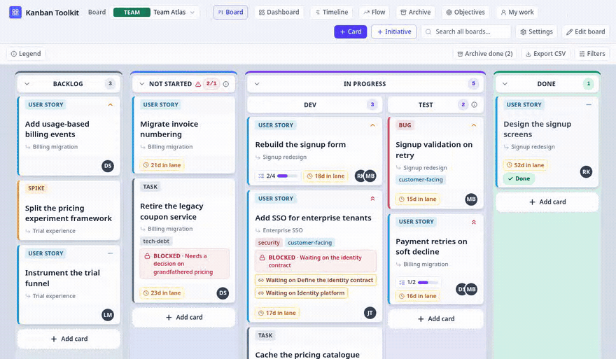
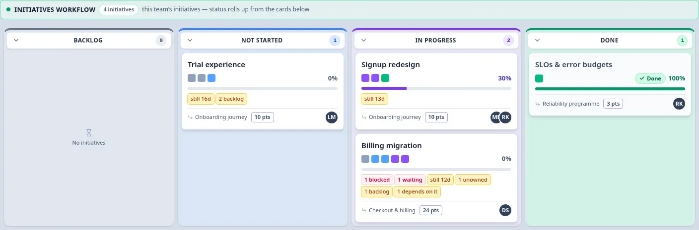

<div align="center">

# Kanban Toolkit

**One board for the team. One clear view for everyone else.**

Kanban Toolkit is a Kanban system for a team's own work, and a simple way to show that work to the people
outside the team. The team keeps its board; other groups read the same work as **initiatives** —
progress, risk and what depends on what — without asking for a status update or keeping a second set
of tickets.

[**Open the demo**](https://kanbantoolkit.com/app) — nothing to sign up for ·
[Run it yourself](#run-it) · [Documentation](docs/README.md)

[](https://github.com/malcolmbastien/kanbantoolkit/actions/workflows/ci.yml) &nbsp; [](LICENSE)



</div>

The demo is the application itself: on a first visit it seeds a complete board, keeps the work in
your browser, and asks you for nothing. Nothing is collected and no account is needed.

**The time is not in the work — it is in the waiting.** Kanban Toolkit puts the wait where it can be read:
how many days a card has sat in its lane, what it is blocked on, what it is waiting for on another
board, and which committed work below has nobody's name on it. None of that is a second report, and
none of it is entered twice — it is read from the cards that are already there.

## How it works

1. **The team works on its board.** Cards move through four fixed stages — **Backlog → Not Started →
   In Progress → Done**. Drag one into the column it belongs in; the column's stage is the card's
   status.
2. **The board is shaped around the work.** Split a stage into the steps your team actually uses,
   name them, arrange them in columns or rows, and set a limit on how much work is in flight where
   that helps. The stage stays underneath, so reporting does not change when the board does. A board
   can carry more than one cards flow — a delivery flow and a support queue, say — each with its own
   columns, its own name and its own limit, stacked as separate bands.
3. **Cards roll up into initiatives.** A card dragged onto an initiative becomes its child: the
   initiative's progress, age and delivery risk are computed from the work below it, so the wider
   view cannot drift from the board.
4. **Everyone else reads the same work.** Leaders, a programme or another team read the initiatives
   flow — what is planned, what is moving and what depends on what — from the same cards, with no
   second set of tickets to keep in step.



## What it gives you

- **A real Kanban board.** Four fixed stages — **Backlog, Not Started, In Progress and Done** — that
  stay honest however your team reshapes the board.
- **A workflow you can shape — or several.** Split a stage into the steps your team actually uses,
  arrange them in columns or rows, give each one a clear name, and set a limit on how much work is in
  flight where it helps. A board can carry more than one cards flow, each with its own columns, and a
  card moves between them like it moves between any two cells. The board belongs to the team, not to
  a template.
- **Initiatives for the wider view.** Day-to-day cards roll up into initiatives, so other groups can
  see progress, age and delivery risk without interrupting the team. The team's board and the wider
  view are two readings of the same work.
- **One card, one truth.** A card keeps its identity, history and owner wherever it is read, so it
  never has to be copied into another system.
- **Private and self-hosted.** Run it on your own machine or server. No ads, no analytics, no
  third-party scripts, and your work is yours to export whenever you want.
- **Open source.** AGPL-3.0. Read it, change it, and run it on your own terms.

## Run it

```bash
git clone https://github.com/malcolmbastien/kanbantoolkit kanbantoolkit
cd kanbantoolkit
docker compose up -d
# open http://localhost:8787/app
```

The image builds, the database is created on a volume, and the first visit sets up the account that
runs the instance. There is nothing else to configure.

<details>
<summary>Run it without Docker</summary>

Node 26 and a directory you own:

```bash
git clone https://github.com/malcolmbastien/kanbantoolkit kanbantoolkit
cd kanbantoolkit
npm ci && npm run build
PORT=8787 DB_PATH=./kanbantoolkit.db STATIC_DIR=./dist npm run server
```

The build writes the site and the application into `dist/`; the server applies every pending
migration on start and prints the schema version it reached.

</details>

For TLS, backups, configuration and the full install path — including the published container image —
see [`docs/install.md`](docs/install.md) and [`docs/docker.md`](docs/docker.md).

## Documentation

- [The guide, browsable](https://github.com/malcolmbastien/kanbantoolkit/wiki) — installing, running
  and using the application; generated from `docs/`.
- [`docs/README.md`](docs/README.md) — the index: architecture, data model, installation and the API.
- [`docs/install.md`](docs/install.md) — running it, configuring it and keeping it going.
- [`docs/backup.md`](docs/backup.md) — exporting and restoring your workspace.
- [`docs/rest-api.md`](docs/rest-api.md) and [`docs/mcp.md`](docs/mcp.md) — the machine doors: a token,
  a REST API and an MCP server for an agent.
- [The site](https://kanbantoolkit.com/) — how the board works in the site's own
  words, how to install it, and what it does with your data.

## Project

- [CONTRIBUTING.md](CONTRIBUTING.md)
- [SECURITY.md](SECURITY.md)
- [CODE_OF_CONDUCT.md](CODE_OF_CONDUCT.md)
- [LICENSE](LICENSE) — AGPL-3.0-or-later

## Licence

Kanban Toolkit is free software under the GNU Affero General Public License, version 3 or later. Run it,
change it, and share your changes when you offer it to other people.

Copyright © 2026 Malcolm Bastien.
