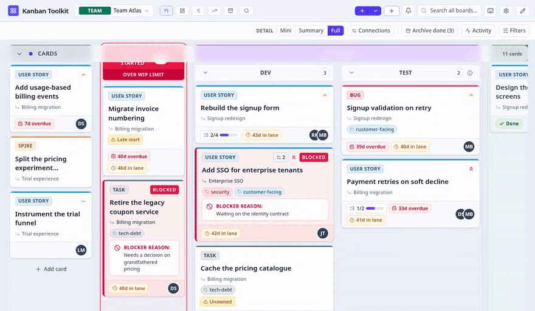
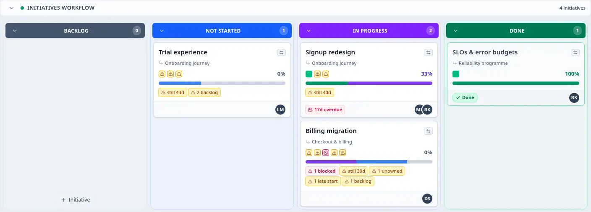

<div align="center">

# Kanban Toolkit

**One board for the team. One view for the program. One line of sight to the OKRs.**

Teams run their day-to-day work on one board; program and project managers read the same cards rolled
up as initiatives across teams; directors and leaders see how the department rolls up to its OKRs.
Nobody keeps a second set of tickets, and nobody waits for a status meeting.

The board shows the wait: how long a card has sat in its lane, what is blocking it, what it is
waiting for on another team's board, and which work in progress has nobody's name on it. All read
from cards that are already there, none typed twice.

[**Run it with Docker**](#run-it) — one container, one SQLite file ·
[Open the demo](https://kanbantoolkit.com/app) · [Documentation](docs/README.md)

[](https://github.com/malcolmbastien/kanbantoolkit/actions/workflows/ci.yml) &nbsp; [](LICENSE)



</div>

The demo is the application itself: a first visit seeds a complete board and keeps the work in
your browser. No account, nothing collected.

## How it works

1. **The team works on its board.** Four fixed stages — **Backlog → Not Started → In Progress →
   Done**. Drag a card into a column: the column's stage is its status.
2. **The board is shaped around the work.** Split a stage into named steps in columns or rows, with
   a limit on work in flight where that helps. The stage stays underneath, so reporting does not
   change when the board does. A board can carry more than one cards flow — delivery and support,
   say — each with its own columns and limits, stacked as separate bands.
3. **Cards roll up into initiatives.** Drag a card onto an initiative to make it a child. Its progress
   and delivery risk are computed from the work below it, so the wider view cannot drift from the
   board.
4. **Other groups read the same work.** A program board, a portfolio or another team reads the
   initiatives flow — what is planned, what is moving and what depends on what — from the same
   cards.



## Features

- **Boards**
  - One or more cards flows per board, stacked as bands, each with its own columns and limits.
  - Drag a card between cells, or between the board's flows.
  - Per-column WIP limits; a limit can tint the column, ask for a reason, or refuse the move.
  - A default card type for new cards, and settings for name, description, band, linked
    boards, card types, tags and initiative types.
  - Edit mode for the board's structure, read mode for using it. Archive and unarchive.
  - A **Detail** dial per board: Mini (colour tiles), Summary (the key facts) or Full (the whole
    card), remembered in this browser and not a permission.
  - A **Connections** lens: every hierarchy and dependency edge between the items a board renders,
    including boundary dependencies to the bottom band, drawn as red strings over the board. Off by
    default and remembered per browser.
  - Workspace Home lists every board by band, with a filter and a search.
- **Cards**
  - Title, Markdown description, type, priority, assignees, tags, target dates and a due date.
  - A link to where the work lives elsewhere — a ticket, a design, a page — kept as a reference: the
    app never fetches it, and only `http`/`https` is stored.
  - Sub-task checklists, comments on the card, and dependencies that clear when the other item
    reaches Done.
  - Mark a card blocked with a reason; give it a parent and children by dropping it on an initiative.
  - The creator is recorded and cannot be changed afterwards.
  - Bulk move, retype, assign, reparent, archive, discard or delete a selection.
- **Initiatives**
  - Status and percentage computed from the cards below, with no estimate or status of their own.
  - The section is derived from the rollup; the cell inside it is arranged by hand.
  - Parent/child decomposition across boards, including a team initiative linked under a management
    initiative.
  - Health flags for blocked, waiting, stale, unowned, unplanned work below, and past target date.
- **Views**
  - Dashboard and timeline of a board's initiatives.
  - Flow metrics on team boards: lead and cycle time, throughput, distributions, weekly ranges,
    aging and WIP by age, net flow, a two-way service level and a forecast.
  - Strategy map on portfolio boards: objectives, key results, the initiatives that serve them, and
    coverage gaps. An objective's completeness comes from the work below it.
  - Archive of completed and discarded work, with restore; finished cards are filed a week after
    they are done.
  - My work for the signed-in person, an inbox for the cards and initiatives you watch, search
    across every board, and a command palette.
  - A watch starts when you make it: the earlier record stays on the card, and the inbox shows only
    what happens next — moved, blocked, edited, commented, filed, a due-date change or an initiative's
    health. Mark all read; a deleted item drops out rather than leaving a dead link.
  - The palette also acts on the open card: assign to me, move to Done, block with a reason, watch,
    set the due date or open the panel, through the same rules the board enforces.
  - Filters for text, type, assignee or unassigned, priority, tags, blocked, overdue, due soon and
    initiative. Saved filters and collapsed columns, kept per device.
  - The address bar names the board, the view and the open card, so a link can be shared.
- **Accounts and collaboration** (instance)
  - Viewer, editor and administrator roles, checked on every request.
  - Sign-in with any OIDC issuer, a password, or a magic link when mail is configured.
  - Invitations with a link, a role, an expiry and a revoke; people and membership management;
    sessions with sign-out everywhere; an audit log with a CSV export; SCIM provisioning.
  - Live updates over a socket or by polling, an editing lease per card, and revision checks that
    refuse a stale write.
  - Opt-in email: immediate, daily or weekly plain-text digests of watched changes, assignments,
    mentions, due work and watched initiatives at risk, with a tokenized unsubscribe link and a
    preferences link. One message per period, computed at send time, and only when the operator
    configured a relay — no third-party mail service and no tracking pixel.
- **Data**
  - Export the workspace as JSON and import it back; export a board's cards as CSV.
  - Back up and restore the SQLite file from the command line.
  - Templates of a board's flows, columns and limits.
  - Browser snapshots, a warning when storage is full, and quarantine of saved data a build cannot
    read.
- **Running it and machine access**
  - A published Docker image for a self-hosted instance: one container and one SQLite file.
  - Personal API tokens with scopes, expiry and rate limits; REST at `/api/v1`; an MCP server over
    HTTP or stdio, with a tool per read and write. `add_note` lets an agent report back without
    changing the plan, and the activity names the token it came through.
  - The same application as a static build (the demo), from the Node entry directly, or on a
    Cloudflare Worker (this project's site, and an optional hosted instance). The container uses none
    of those.
  - A skill in [`skills/kanbantoolkit/SKILL.md`](skills/kanbantoolkit/SKILL.md) teaches a model the
    board's shape, the rules that will refuse it, and the order to read in.
  - Keyboard access, screen-reader labels and focus handling.
  - No ads, analytics or third-party scripts. Error reports carry the error, path, view, build and
    browser, and no workspace data.

## Run it

Kanban Toolkit runs as a **published Docker image** — nothing to clone, nothing to compile:

```bash
printf 'ERROR_SALT=%s\n' "$(openssl rand -hex 32)" > .env
docker run -d --name kanbantoolkit --restart unless-stopped \
  -p 127.0.0.1:8787:8787 \
  -v kanbantoolkit-data:/data \
  --env-file .env \
  ghcr.io/malcolmbastien/kanbantoolkit:latest
# open http://localhost:8787/app
```

The container creates the database on the volume, and the first visit sets up the account that runs
the instance. `ERROR_SALT` is the one value the image will not guess: it is mixed into the hash of a
reporter's address, so it must be a secret, and the image **refuses to start without it**. Put
`WORKSPACE_NAME` and `PUBLIC_URL` in the same env file when the machine has a public address;
[configure.md](docs/configure.md) says what each one does. The port is bound to loopback, so a
reverse proxy is the way in ([tls.md](docs/tls.md)).

The tags are `<commit>`, `<version>` and `latest`; pin a version for a real instance, and use
`latest` only for a trial. [docker.md](docs/docker.md) is the full container path — the volume,
backups taken inside it, upgrades, and what SQLite means.

<details>
<summary>Build the image from this repository</summary>

The checkout's Compose file builds the same image locally:

```bash
git clone https://github.com/malcolmbastien/kanbantoolkit kanbantoolkit
cd kanbantoolkit
printf 'ERROR_SALT=%s\n' "$(openssl rand -hex 32)" > .env
docker compose up -d --build
```

</details>

<details>
<summary>Run from source without Docker</summary>

Node 26 and a directory you own — the development path, not what users are expected to run:

```bash
git clone https://github.com/malcolmbastien/kanbantoolkit kanbantoolkit
cd kanbantoolkit
npm ci && npm run build
NODE_ENV=production ERROR_SALT=$(openssl rand -hex 32) \
  PORT=8787 DB_PATH=./kanbantoolkit.db STATIC_DIR=./dist npm run server
```

The server applies every pending migration on start and prints the schema version it reached. A run
without `ERROR_SALT` is a development run: it starts with a salt generated for the process, so a real
instance should keep the value in its unit file ([docs/install.md](docs/install.md)).

</details>

For TLS, configuration and the full install path, see [`docs/install.md`](docs/install.md) and
[`docs/docker.md`](docs/docker.md).

## Documentation

- [The guide, browsable](https://github.com/malcolmbastien/kanbantoolkit/wiki) — installing, running
  and using the application; generated from `docs/`.
- [`docs/README.md`](docs/README.md) — the index: architecture, data model, installation and the API.
- [`docs/install.md`](docs/install.md) — running it, configuring it and keeping it going.
- [`docs/backup.md`](docs/backup.md) — exporting and restoring your workspace.
- [`docs/rest-api.md`](docs/rest-api.md) and [`docs/mcp.md`](docs/mcp.md) — the machine doors: a token,
  a REST API and an MCP server for an agent.
- [The site](https://kanbantoolkit.com/) — how the board works in the site's own
  words, how to install it, and what it does with your data.

## Project

- [CONTRIBUTING.md](CONTRIBUTING.md)
- [SECURITY.md](SECURITY.md)
- [CODE_OF_CONDUCT.md](CODE_OF_CONDUCT.md)
- [LICENSE](LICENSE) — AGPL-3.0-or-later

## Licence

Kanban Toolkit is free software under the GNU Affero General Public License, version 3 or later. Run it,
change it, and share your changes. If you run a modified version for other people over a network,
you must offer them its source.

Copyright © 2026 Malcolm Bastien.
