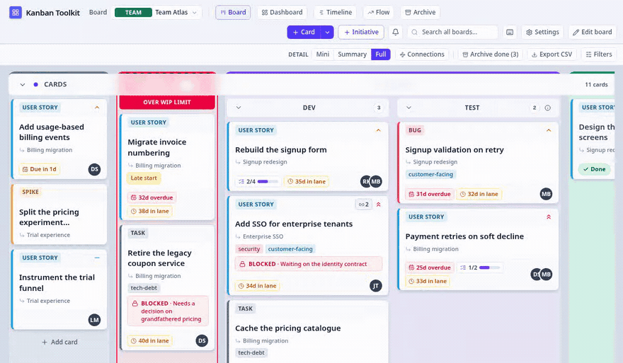
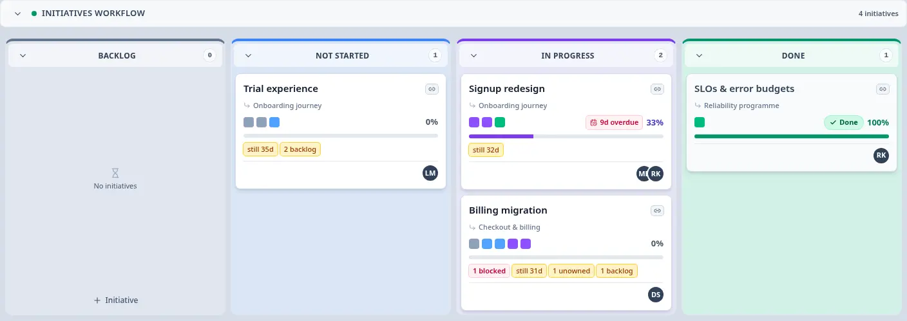

<div align="center">

# Kanban Toolkit

**One board for the team. One clear view for everyone else.**

Kanban Toolkit is a Kanban board for a team's own work, and a way to show that work to the people
outside the team. The team keeps its board; other groups read the same cards as **initiatives** —
progress, risk and what depends on what — without a status meeting or a second set of tickets.

The wait is on the board too: how long a card has sat in its column, what it is blocked on, what it
is waiting for on another board, and which committed work has nobody's name on it. All of it read
from cards that are already there, none of it typed twice.

[**Open the demo**](https://kanbantoolkit.com/app) — nothing to sign up for ·
[Run it yourself](#run-it) · [Documentation](docs/README.md)

[](https://github.com/malcolmbastien/kanbantoolkit/actions/workflows/ci.yml) &nbsp; [](LICENSE)



</div>

The demo is the application itself. A first visit seeds a complete board and keeps the work in your
browser. There is no account and nothing is collected.

## How it works

1. **The team works on its board.** Cards move through four fixed stages — **Backlog → Not Started →
   In Progress → Done**. Drag one into a column and the column's stage is the card's status.
2. **The board is shaped around the work.** Split a stage into the steps your team actually uses,
   name them, arrange them in columns or rows, and set a limit on work in flight where that helps.
   The stage stays underneath, so reporting does not change when the board does. A board can carry
   more than one cards flow — delivery and support, say — each with its own columns and limits,
   stacked as separate bands.
3. **Cards roll up into initiatives.** A card dragged onto an initiative becomes its child. The
   initiative's progress and delivery risk are computed from the work below it, so the wider view
   cannot drift from the board.
4. **Other groups read the same work.** A program board, a portfolio or another team reads the
   initiatives flow — what is planned, what is moving and what depends on what — from the same
   cards.



## Features

- **Boards**
  - Four fixed stages. A stage splits into named cells, arranged in columns or rows.
  - One or more cards flows per board, stacked as bands, each with its own columns and limits.
  - Drag a card between cells, or between the board's flows.
  - Per-column WIP limits; a limit can tint the column, ask for a reason, or refuse the move.
  - A default card type for new cards, and settings for name, description, band, linked
    boards, card types, tags and initiative types.
  - Edit mode for the board's structure, read mode for using it. Archive and unarchive.
  - A **Detail** dial per board: Mini (colour tiles), Summary (the key facts) or Full (the whole
    card), remembered in this browser and not a permission.
  - A **Connections** lens: every hierarchy and dependency edge between the items a board renders,
    including boundary dependencies to the bottom band, drawn as red strings over the board. Off by
    default and remembered per browser.
  - Workspace Home lists every board by band, with a filter and a search.
- **Cards**
  - Title, Markdown description, type, priority, assignees, tags, target dates and a due date.
  - A link to where the work lives elsewhere — a ticket, a design, a page — kept as a reference: the
    app never fetches it, and only `http`/`https` is stored.
  - Sub-task checklists, comments on the card, and dependencies that clear when the other item
    reaches Done.
  - Mark a card blocked with a reason; give it a parent and children by dropping it on an initiative.
  - The creator is recorded and cannot be changed afterwards.
  - Bulk move, retype, assign, reparent, archive, discard or delete a selection.
- **Initiatives**
  - Status and percentage computed from the cards below, with no estimate or status of their own.
  - The section is derived from the rollup; the cell inside it is arranged by hand.
  - Parent/child decomposition across boards, including a team initiative linked under a management
    initiative.
  - Health flags for blocked, waiting, stale, unowned, unplanned work below, and past target date.
- **Views**
  - Dashboard and timeline of a board's initiatives.
  - Flow metrics on team boards: lead time, cycle time, throughput, distributions, aging and a
    forecast.
  - Strategy map on portfolio boards: objectives, key results, the initiatives that serve them, and
    coverage gaps. An objective's completeness comes from the work below it.
  - Archive of completed and discarded work, with restore; finished cards are filed a week after
    they are done.
  - My work for the signed-in person, an inbox for the cards and initiatives you watch, search
    across every board, and a command palette.
  - A watch starts when you make it: the card's earlier record stays on the card, and the inbox shows
    only what happens next — moved, blocked, edited, commented, filed, a due-date change or an
    initiative's health. Mark all read, and a deleted item drops out rather than leaving a dead link.
  - The palette also acts on the open card: assign to me, move to Done, block with a reason, watch,
    set the due date or open the panel, through the same rules the board enforces.
  - Filters for text, type, assignee or unassigned, priority, tags, blocked, overdue, due soon and
    initiative. Saved filters and collapsed columns, kept per device.
  - The address bar names the board, the view and the open card, so a link can be shared.
- **Accounts and collaboration** (instance)
  - Viewer, editor and administrator roles, checked on every request.
  - Sign-in with any OIDC issuer, a password, or a magic link when mail is configured.
  - Invitations with a link, a role, an expiry and a revoke; people and membership management;
    sessions with sign-out everywhere; an audit log with a CSV export; SCIM provisioning.
  - Live updates over a socket or by polling, an editing lease per card, and revision checks that
    refuse a stale write.
  - Opt-in email: immediate, daily or weekly plain-text digests of watched changes, assignments,
    mentions, due work and watched initiatives at risk, with a tokenized unsubscribe link and a
    preferences link. One message per period, computed at send time, and only when the operator
    configured a relay — no third-party mail service and no tracking pixel.
- **Data**
  - Export the workspace as JSON and import it back; export a board's cards as CSV.
  - Back up and restore the SQLite file from the command line.
  - Templates of a board's flows, columns and limits.
  - Browser snapshots, a warning when storage is full, and quarantine of saved data a build cannot
    read.
- **Running it and machine access**
  - A static build that runs with no server, keeping the workspace in the browser, or a self-hosted
    instance: one Node process and one SQLite file.
  - Docker image, Compose file and a Cloudflare Worker entry.
  - Personal API tokens with scopes, expiry and rate limits; REST at `/api/v1`; an MCP server over
    HTTP or stdio, with a tool per read and write. `add_note` lets an agent report back without
    changing the plan, and the activity names the token it came through.
  - A skill in [`skills/kanbantoolkit/SKILL.md`](skills/kanbantoolkit/SKILL.md) teaches a model the
    board's shape, the rules that will refuse it, and the order to read in.
  - Keyboard access, screen-reader labels and focus handling.
  - No ads, analytics or third-party scripts. Error reports carry the error, path, view, build and
    browser, and no workspace data.

## Run it

```bash
git clone https://github.com/malcolmbastien/kanbantoolkit kanbantoolkit
cd kanbantoolkit
printf 'ERROR_SALT=%s\n' "$(openssl rand -hex 32)" > .env
docker compose up -d
# open http://localhost:8787/app
```

The image builds, the database is created on a volume, and the first visit sets up the account that
runs the instance. `ERROR_SALT`, in the `.env` file above, is the one value the image will not guess:
it is mixed into the hash of a reporter's address, so it has to be a secret rather than a default,
and the image **refuses to start without it**. `PUBLIC_URL` is the other one worth setting, when the
machine has a public address. [configure.md](docs/configure.md) says what each one does.

<details>
<summary>Run it without Docker</summary>

Node 26 and a directory you own:

```bash
git clone https://github.com/malcolmbastien/kanbantoolkit kanbantoolkit
cd kanbantoolkit
npm ci && npm run build
NODE_ENV=production ERROR_SALT=$(openssl rand -hex 32) \
  PORT=8787 DB_PATH=./kanbantoolkit.db STATIC_DIR=./dist npm run server
```

The build writes the site and the application into `dist/`. The server applies every pending
migration on start and prints the schema version it reached. A run without `ERROR_SALT` is a
development run: it starts with a salt generated for the process, so a real instance should keep the
value in its unit file ([docs/install.md](docs/install.md)).

</details>

For TLS, backups, configuration and the full install path — including the published container image —
see [`docs/install.md`](docs/install.md) and [`docs/docker.md`](docs/docker.md).

## Documentation

- [The guide, browsable](https://github.com/malcolmbastien/kanbantoolkit/wiki) — installing, running
  and using the application; generated from `docs/`.
- [`docs/README.md`](docs/README.md) — the index: architecture, data model, installation and the API.
- [`docs/install.md`](docs/install.md) — running it, configuring it and keeping it going.
- [`docs/backup.md`](docs/backup.md) — exporting and restoring your workspace.
- [`docs/rest-api.md`](docs/rest-api.md) and [`docs/mcp.md`](docs/mcp.md) — the machine doors: a token,
  a REST API and an MCP server for an agent.
- [The site](https://kanbantoolkit.com/) — how the board works in the site's own
  words, how to install it, and what it does with your data.

## Project

- [CONTRIBUTING.md](CONTRIBUTING.md)
- [SECURITY.md](SECURITY.md)
- [CODE_OF_CONDUCT.md](CODE_OF_CONDUCT.md)
- [LICENSE](LICENSE) — AGPL-3.0-or-later

## Licence

Kanban Toolkit is free software under the GNU Affero General Public License, version 3 or later. Run it,
change it, and share your changes. If you run a modified version for other people over a network,
you must offer them its source.

Copyright © 2026 Malcolm Bastien.
