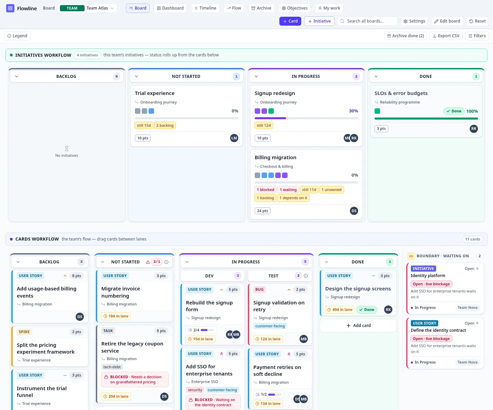

# Flowline

**Work is a graph. Boards are views. Types are yours.**

Flowline is a board for a team's flow and for the read management makes of it — on your own machine:
one Node process, one SQLite file, and no service in between.



```bash
git clone https://github.com/flowline/flowline && cd flowline
docker compose up -d        # then open http://localhost:8787/app
```

Nothing to configure first: the image builds, the database is created on a volume, and the first visit
offers the account that runs the instance. Without Docker, the same thing by hand:

```bash
npm ci && npm run build && PORT=8787 npm run server
```

The workspace is named by the installation (`WORKSPACE_NAME`, default `Flowline`), and the first
account to make administers it. There is no sign-up: an instance *is* a workspace. Both roads are in
[`docs/install.md`](docs/install.md), and the container's own details in
[`docs/docker.md`](docs/docker.md).

| | |
| --- | --- |
| **Install** | [the install page](site/pages/install.html) — the same commands, what the process reads, the honest limits |
| **Docs** | [`docs/`](docs/) — the two runtimes, the data model, backups, and where it is going |
| **Licence** | [AGPL-3.0-or-later](LICENSE) — run it, change it; a modified version you run for other people publishes its changes |
| **Contributing** | [CONTRIBUTING.md](CONTRIBUTING.md) · [SECURITY.md](SECURITY.md) · [CODE_OF_CONDUCT.md](CODE_OF_CONDUCT.md) |
| **The one rule** | [AGENTS.md](AGENTS.md) — no Firebase, no Google tracking, no Google Cloud or AI, no Google Fonts |

Flowline is a prototype built from [`flowline-mvp-prd.md`](./flowline-mvp-prd.md) and then
generalised (see [`docs/data-model-v2.md`](./docs/data-model-v2.md)). It replaces the fixed
`Initiative > Epic > Story` hierarchy with:

- **A generic parent/child hierarchy** — any card has **one parent** and **any number of
  children**. Structural **depth** is derived from that chain; there is no level field.
- **User-defined issue types** — create, rename and recolour types in-app. A type is a
  label + colour; any type can sit in any column.
- **LeanKit-style lane boards** — a recursive lane tree. A **leaf lane is a cell**; a
  **container** arranges its children in columns (side by side) or rows (stacked). Any cell
  can be split into a container of either orientation, recursively — so the grid is
  **non-uniform**, exactly like LeanKit. All design controls (split / add / rename /
  remove lanes) live behind an **Edit board** mode.
- **Fixed post-it cards, fluid lanes.** A card is a fixed 180×112 note; lanes **expand to
  fit every card** in them (no in-cell scrolling), so a row is as tall as its busiest cell.
- **Flight-level badge.** Every board is labelled by Kanban flight level — **Team**,
  **Program**, or **Portfolio** — shown as a badge on the board picker in the toolbar and
  set under **Board settings**. It's an orientation label for a board, distinct from an
  item's derived `depth`.
- **Coordination boards vs team boards.** The band picks a board's lens. A **team** board
  renders work: an **Initiatives workflow** (its initiatives, positioned by rollup) over the
  **Cards workflow**. A **program** board aggregates: the same **Initiatives workflow** plus
  **Linked boards** — a rollup band per board it aggregates. A **portfolio** board leads with
  a **Strategy map**, and with nothing else: each **objective** heads the board's own
  **initiatives workflow**, holding the strategic initiatives attributed to it in the columns
  their own work puts them in — so the connection and the progress read together. Both coverage
  gaps are inline (an objective no initiative serves, an initiative no objective carries, which
  gets a flow of its own). A portfolio shows no bands — what the work is *for* is its reading, and
  the rollups beneath it belong to the programme boards. Pick a board from the **Board** menu.
- **Custom initiative flows.** A typed column can be **split** into cells, and an initiative
  can be moved between the cells of its own column — so a board can define its own flow. The
  *column* stays derived from the work (that's the rollup), the *cell* is the user's
  arrangement, and the same split is visible in every place that board's flow appears — its own
  initiatives workflow, and any program's Linked boards band.
- **Initiatives on boards; cards beneath.** A board's flow shows its **Initiative-typed
  items** (positioned by rollup); their children are the detailed cards, seen by opening an
  initiative. From a management initiative you can **link** down to a new team initiative: it's
  created on a team board as a child, so its cards roll up the hierarchy.
- **Three typed columns.** Every board's top level is exactly three columns typed
  **Not Started / In Progress / Done**. A leaf's status is the *type* of the column it
  ultimately sits under, which is what makes status roll up the hierarchy. The top-level
  columns are fixed — you refine them by **splitting** (e.g. In Progress → Dev / Test), and
  sub-lanes inherit the type; the editor hides add/remove/flip/rename there.
- **Explicit placements** — a card's board + cell is stored as a `Placement` record (one
  per board), so a single card can still live on several boards with one identity.

And the derived facts that don't go away: **dependency state** is computed from both
endpoints' cells, and **attribution never counts as work**.

## No Firebase, no tracking

This app has **no Firebase, no Google tracking, and no third-party font host**, by design.
Sign-in is an OIDC issuer the operator configures (see `AGENTS.md` for the policy), so the product
ships no vendor of its own; the current build makes no external requests at all.

- Runtime: a static Vite + React SPA. All state is in the browser (`localStorage`).
  No backend, no auth, no cloud services of any kind.
- Deploy target: **Cloudflare Workers** with static assets (build in `dist/`, config in
  `wrangler.jsonc`). Any static host still works: the app is a plain SPA.
- The only external service is the LLM used **offline at authoring time** by Taskmaster,
  which talks to your **OpenCode Go** subscription.

## Quick start

Node **26** (the version CI runs). Install, then dev:

```bash
npm install
npm run dev          # http://localhost:5173/app — the app lives under /app
```

```bash
npm run build        # tsc -b && vite build && the site  ->  dist/
npm run preview      # serve the build: the site at /, the app at /app
npm run site:check   # the site's pages: named, self-contained, inside their budget
npm test             # Vitest: derivation + store behaviour
npm run lint         # oxlint
npm run scan         # the AGENTS.md dependency rule (no Firebase, no Google tracking)
npm run test:e2e     # Playwright: builds, serves and drives the real app
npm run size         # the first download's size, measured from the build
npm run server       # the self-hosted entry: Node, a SQLite file, the built client
npm run backup -- backup <db> <dir>   # a consistent copy while the server keeps running
npm run backup -- restore <file> <db> # put it back, verified (see docs/backup.md)
npm run smoke:node   # boots that entry and uses the API, so the second runtime cannot rot
```

Every push to `main` and every pull request runs `.github/workflows/ci.yml` on Node 26: typecheck,
lint, tests, the `AGENTS.md` dependency scan, the production build, the site's checks, and the
first-download measurement in a job named `checks`;
then the Playwright suite against the built app, in a job named `e2e`, which keeps its traces when
it fails. Publishing waits on both, so a red test never reaches the live app.

### URLs

**Everywhere the app can be has a URL, and the URL is the app's own state.** Where you are is a
board, a view of it, and the card or initiative open over it — three facts, one canonical query:

```
/app?board=b-atlas                          the board's own flow (the Board tab)
/app?board=b-atlas&view=dashboard           a view of that board
/app?board=b-atlas&item=init-signup         a card or initiative open on it
/app?board=b-atlas&view=timeline&item=…     both at once
```

The query is **canonical**: it is rebuilt from the state on every change and anything the app does
not recognise is dropped, so one place has exactly one URL and two people looking at the same thing
hold the same link. Switching board or view is a step the back button undoes; opening a card is not
(it is the same place with something drawn over it, so it rewrites the step it is on rather than
leaving a duplicate behind).

| `view=` | |
| --- | --- |
| *(absent)* | the board's own flow — the Board tab |
| `dashboard` | the board's initiatives, summarised |
| `timeline` | the board's initiatives over time |
| `flow` | the board's delivery metrics, read from each card's history |
| `archive` | filed-away items |
| `mywork` | everything assigned to the workspace's person |
| `boards` | the workspace: every board |
| `objectives` | objectives and their coverage |

**Intentions.** These are read once, on arrival, and normalised away — they say what to *do* with a
link rather than where it points, so they are never written back:

```
?q=signup                     narrow the board to a text query (and seed the finder)
?filters=1                    open the filter panel
?filters=blocked,overdue      …and apply those filters
?collapse=<laneId>            start with that column collapsed (repeatable)
?select=id1,id2               pre-select cards in the multi-select group
?lens=<itemId>                focus a lineage
?boundary=<id>                open a boundary
?edit=1                       start in board edit mode
?stress=300                   build a load-test board of 300 cards
```

`?edit=` is deliberately an intention and not a place: edit mode is a mode, and the back button
must never be the thing that throws a board design away. A link naming a board or a card that is
not here — from another dataset, or to something since deleted — lands on what *is* there rather
than on a blank surface.

## Deploying

```bash
npm run build
npm run deploy       # wrangler deploy -> the `flowline` Worker
```

CI publishes on every push to `main`, after the `checks` job passes, using the
`CLOUDFLARE_API_TOKEN` and `CLOUDFLARE_ACCOUNT_ID` repository secrets. Without them the deploy job
skips and the build stays green. A pull request uploads a preview version instead of deploying.

`_headers` carries the response policy: a content-security policy with no third-party origins,
`nosniff`, and a referrer policy. Hashed assets are immutable; the document is revalidated so a
deploy is visible immediately. Adding a view that calls a host, or a measurement script, means
adding its origin to the policy in the same change.

## Signing in

The board needs no server and no account: `dist/` on any host is the whole app. Accounts are
**configuration**, and every provider is optional, so an instance with none configured is a valid
instance with no sign-in at all.

| Variable | What it is |
| --- | --- |
| `AUTH_OIDC_CLIENT_ID`, `AUTH_OIDC_CLIENT_SECRET` | your issuer's client credentials |
| `AUTH_OIDC_AUTHORIZE_ENDPOINT`, `AUTH_OIDC_TOKEN_ENDPOINT`, `AUTH_OIDC_USERINFO_ENDPOINT` | where that issuer lives |
| `AUTH_OIDC_LABEL` | what the button calls it (defaults to the issuer's host) |
| `AUTH_OIDC_SCOPE` | what it asks for (defaults to `openid email profile`) |
| `PUBLIC_URL` | the address the redirect URI is built from, when it differs from the request's |
| `AUTH_DEV=1` | a development identity switch: an address, no provider, no password |

A provider is offered when both its client id and secret are present; nothing else is needed, and no
code changes to add one. The first person to arrive administers the instance and its one workspace;
everyone after them is a member, or arrives with the role an invitation gave their address. The same
**verified** address through two providers is one account, not two.

An instance with no provider is not locked out: a **password** works wherever an account has one. The
first run creates the first administrator (only while it is the only way in), an invitation is where a
colleague chooses theirs, and a **magic link** — a fifteen-minute single-use email — is there when a
mail relay is configured (`SMTP_URL`, `MAIL_FROM`). Without a relay, an administrator mints the same
reset link and hands it over; either way, setting a password ends every other session.

The switch is off unless it is asked for by name, because an instance that is merely running locally
is not an instance anyone should be able to walk into.

## One instance, one workspace

Each deployment is one team's workspace. The **installation** names it — `WORKSPACE_NAME`, defaulting
to `Flowline` — the first account to sign in administers it, and everybody else arrives by
invitation. There is no workspace switcher, no "create a workspace" and no sign-up page: a second
team is a second deployment, not a second row, and `POST /api/workspaces` answers with a sentence
that says so. The `workspace_id` columns and the seal every route goes through stay: one workspace
makes them redundant, which is exactly why keeping them costs nothing.

## What to try

Things to try:

1. **Custom types** — open **Types**; rename/add a type and recolour it. A card can be any type.
2. **Generic hierarchy** — open a card; set its parent or add a child (choose the child's
   type). One parent, many children; depth updates.
3. **Edit board** — create a **new board**, then build any layout: split a cell into
   **columns** or **rows** (locally — Team Alpha's `In Progress` is split, Team Bravo's is
   not), **add** lanes, **flip** a container's orientation, mark **start/done** columns, set
   **WIP** limits, rename and remove. Experiment freely: **Save** keeps the design,
   **Cancel** reverts to the state you started editing from.
4. **Initiatives roll up** — open *Onboarding Redesign*: its children are team initiatives (one per team board), never cards; each team initiative's cards roll up into its %.
5. **Dependency self-cleans** — set "API decision" to Done; the blocked story flips to
   Satisfied with nobody touching it.
6. **Attribution never inflates** — map *Build signup form* to an objective and the WIP count
   does not move; map it to a second and it *moves* there instead, because an initiative serves
   one objective.
7. **WIP limits are visible, not enforced** — a lane over its limit shows red; moves are never blocked.

## Architecture

```
src/
  domain/
    types.ts     # IssueType, Board, Lane, Item, Placement, Edge  (no board/level field on Item)
    lanes.ts     # lane tree: leaves, depth, spans, per-lane WIP counts
    derive.ts    # depth, statusOf (from the cell), dependencyState, pressure, attribution
    board.ts     # items on a board (via placements), types, kinds, tags
    seed.ts      # the demo graph: custom types, two boards, a split column, multi-board placement
  store.ts       # zustand + localStorage; placements, lane splits, type CRUD, single parent
  components/     # TopBar, BoardView (nested lanes), Card, BoundaryPin, ItemPanel, TypeEditor
  lib/            # class utils, colour helpers
```

- A **board** owns a recursive **lane tree**: a leaf lane is a cell that holds cards; a
  container arranges children in columns or rows. `leafLanes()` flattens it; the renderer
  recurses so the grid can be non-uniform. `splitLane`/`addLane`/`removeLane` mutate the
  tree; all design controls show only in **edit mode**.
- **Status is derived from the column type**: a leaf's status is the `stage` of the
  top-level column it sits under (sub-lanes inherit it), and `statusOf()` reads that.
  Dependency state is arithmetic over two cells.
- **`setParent`** drops any existing decomposition parent, enforcing one parent.

### Collaboration (designed, not built)

The app is local-first and single-user today. A team deployment needs one person to hold a
card's pen at a time; [`docs/collaboration.md`](./docs/collaboration.md) sets out the lease, the
revision check that makes a lapsed lease safe, what is locked (content and relationships) and
what is deliberately not (arrangement), and the groundwork the store needs first. None of it is
implemented.

## Error reports

The app reports uncaught errors and rejected promises to `POST /api/errors` — the one server-side
route; everything else is static. A report carries the message, the stack, the path, the view, the
build and the browser. It never carries a place's **query**, which is where board and item ids
live, and the address is stored only as a salted hash, at most thirty reports an hour.

To turn it on, once:

```bash
npx wrangler d1 create flowline-errors       # prints a database id
# paste the id into the d1_databases block in wrangler.jsonc, uncomment it, then:
npx wrangler d1 migrations apply flowline-errors --remote
npm run deploy
```

Until then the endpoint answers `503`, the app is unaffected, and development sends nothing at all.
Read the log in the Cloudflare dashboard — D1 → `flowline-errors` → Console — or add a screen to
Admin once there are accounts.

## Taskmaster (authoring workflow)

Task generation uses [Task Master](https://github.com/eyaltoledano/claude-task-master)
driven by the **OpenCode Go** subscription — not Google. The gateway requires an
`x-opencode-session` header that off-the-shelf clients don't send, so a tiny zero-dependency
reverse proxy injects it:

```bash
npm run taskmaster:proxy      # terminal 1: http://127.0.0.1:8788 -> https://opencode.ai/zen/go/v1
task-master list              # terminal 2
task-master parse-prd .taskmaster/docs/prd.md
```

- `OPENAI_COMPATIBLE_API_KEY` lives in `.env` (gitignored; see `.env.example`).
- Models are configured in `.taskmaster/config.json`.
- Tags: `master` (the original MVP breakdown) and `backlog` (the post-foundation
  feature backlog, `.taskmaster/docs/features.md`). Use `task-master list --tag=backlog`.
