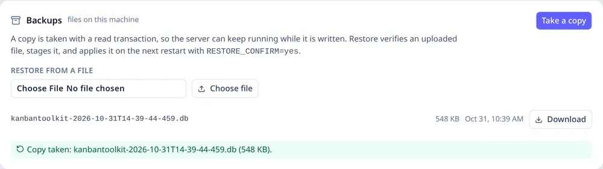

# Backup and restore

> **Owner:** the repository maintainer. Update this line when that changes.
> **Last drill:** 2026-10-23 — automated, by `server/backup.test.ts`, and it runs on every push.

## What has to be copied

One database. Everything a server holds is in it: accounts, sessions, boards, lanes, items, the
history a card carries, the change feed and the leases. There are no uploads and no object storage,
so a backup of the database is a backup of the workspace.

The browser's own `localStorage` is a cache, not a backup. `docs/server-runtime.md` says why.

## Self-hosted: the copy

```bash
npm run backup -- backup ./kanbantoolkit.db ./backups
# backed up ./kanbantoolkit.db → ./backups/kanbantoolkit-2026-10-23T02-00-00-000.db (412 KB, keeping 30 days)
```

The copy is taken with `VACUUM INTO`, a single read transaction: consistent while the server keeps
running, and compact. A plain file copy can catch a write half-written.

Daily, from cron:

```cron
0 2 * * *  cd /srv/kanbantoolkit && npm run backup -- backup ./kanbantoolkit.db ./backups >> ./backups/backup.log 2>&1
```

**Retention** is 30 days by default (`--keep-days=30`), pruned by the file's own timestamp.

### From Admin

**Admin → Backups** takes the same copy, in `BACKUP_DIR` (beside the database by default), and lists
the files with their size and time. **Download** saves one; **Restore from a file** verifies an
uploaded database and stages it. It does **not** replace the live file while connections are open.
The screen says what was verified and what to do next.



*Admin → Backups: a verified copy, a list of the copies on the machine, and the stage-and-restart
route for putting one back.*

A Worker has no filesystem. Its Backups tab says the database provider owns backup and restore, and
points at the provider's console.

**A second copy, on a different machine or with a different provider, is not optional.** A backup on
the machine that fails is not a backup. Any of these, nightly, after the copy:

```bash
rclone sync ./backups remote:kanbantoolkit-backups
# or: restic backup ./backups
# or: scp -r ./backups host:/elsewhere/kanbantoolkit
```

## Self-hosted: putting it back

```bash
npm run backup -- restore ./backups/kanbantoolkit-2026-10-23T02-00-00-000.db ./kanbantoolkit.db --force
# restored … (3 boards, 128 items)
```

It refuses to overwrite without `--force`: a restore runs on a day something has already gone wrong.
After copying it checks `PRAGMA integrity_check` and the row counts, so the command says *what* it
restored.

Then restart the server. The migrations run on boot (`server/migrate.ts`).

A restore staged from **Admin → Backups** is applied by the Node entry on the next boot when
`RESTORE_CONFIRM=yes` is set. The live database is first copied to `pre-restore-<stamp>.db` beside it,
so the restore has its own undo. Without the variable the pending file stays where it is and the
startup log says so.

## Hosted: Cloudflare D1

D1 keeps its own history, and it is the provider's to keep:

- **Time Travel** — automatic, 30 days, restore to any minute:
  `npx wrangler d1 time-travel restore kanbantoolkit --timestamp=2026-10-22T02:00:00Z`
- **An export**, for a copy outside Cloudflare:
  `npx wrangler d1 export kanbantoolkit --remote --output=kanbantoolkit-2026-10-23.sql`

The export is the second copy: keep it somewhere that is not the same account. It is a `.sql` file,
and restoring it is `wrangler d1 execute kanbantoolkit --remote --file=…`.

Cloudflare runs the schedule. Check once a quarter that Time Travel is still available, and that the
export job still runs.

## The drill

Do this at least once a quarter, and after any change to the schema or the deployment:

1. **Take an export from the app.** Sign in as the workspace's administrator and choose **Admin → Workspace
   data → Export**. This is the known-good answer, in the app's own vocabulary.
2. **Restore yesterday's backup into a scratch environment** — a second database file, or a second
   branch of D1. Never over the live one.
3. **Compare.** The restored workspace's export should equal the one from step 1, apart from what
   changed in between. Counts are the quick check: boards, items, placements, edges, and the log
   entries are in the restored copy.
4. **Record the date.** Update the "Last drill" line at the top of this file.

The automated part — seed a workspace, back it up, restore it into a scratch file, compare the whole
workspace object — runs in `server/backup.test.ts` on every push. It cannot reach the provider's
backups, so the manual steps above are still needed.

## What this does not cover

- **The browser's snapshots.** They are a ring in `IndexedDB`, for a bad edit in a tab: not a backup,
  and never a substitute for one.
- **Configuration.** The provider's client secrets and the database path live in the environment;
  they are documented in [configure.md](configure.md) and should be kept wherever the operator keeps
  secrets.
