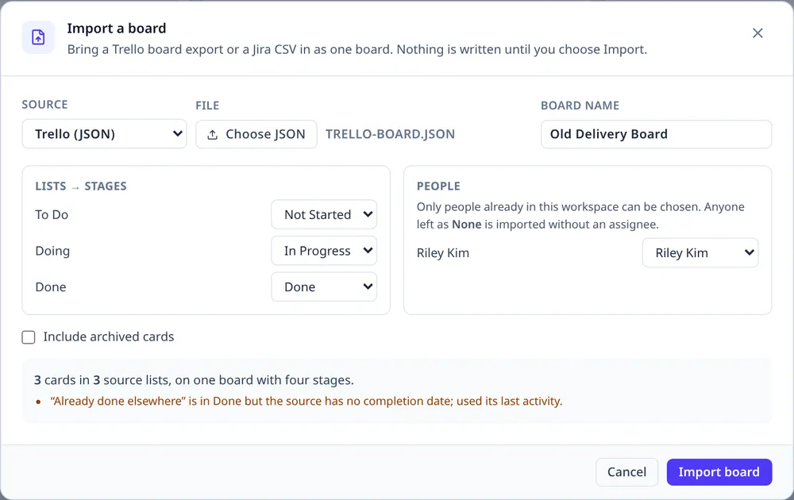

# Importing a board

**Workspace Home → Import board…** (or **Admin → Workspace data**) reads a Trello board export or a
Jira CSV and creates **one** new board. It never replaces another board, and Cancel leaves the
workspace exactly as it was.

## Trello

In Trello choose **Menu → Print, export and share → Export as JSON**, and choose that file. The
import reads:

- lists → the four stages, with a mapping you can change;
- cards → titles, descriptions, labels, members, checklists and due dates;
- archived cards only if **Include archived cards** is chosen.

Attachments and comments are not imported. A Trello card's **last activity** is used as its created
date, and as the completion date of a done card; both produce a warning so the inference is visible.

## Jira

Export the issues you want as **CSV** with these columns (names are matched case-insensitively):

`Issue key`, `Summary`, `Description`, `Issue Type`, `Status`, `Assignee`, `Labels`, `Created`,
`Resolved`, `Due date`, `Parent`.

The import reads statuses as the source lists, maps issue types and people, keeps labels as board
tags, and turns a parent key into the decomposition edge when both rows are imported. Comments,
attachments and issue links are not imported.

## The mapping step

*The mapping step: what the source calls a list becomes a stage, a person becomes somebody here, and
the preview says what will be created.*

- **Lists → stages.** Every source list maps to Backlog, Not Started, In Progress or Done. Two
  source lists mapped to the same stage become two **cells** in that column, named after the lists.
- **People.** Each source person can be associated with a person already in this workspace. Anyone
  left as **None** is imported without an assignee, and the preview says how many names were
  unmatched.
- **Types.** Each Jira issue type maps to one of the workspace's card types. A missing or unmatched
  type becomes **None**, and the warning says so.

The preview says how many cards will be created, and lists the warnings — including any people it
could not match — before anything is written.

## What is created

One team board with a **Cards** flow (the four typed columns, split where the mapping needs it) and
the standard **Initiatives** flow. Imported cards carry a log entry naming the source and its key,
readable in History. A used tag is added to the board's own tags; the workspace directory is
unchanged — an import never creates a person.

## What is not

There is no automatic re-import or two-way sync. A whole-workspace JSON restore is a different act,
under [Workspace data](using.md#the-workspace).
