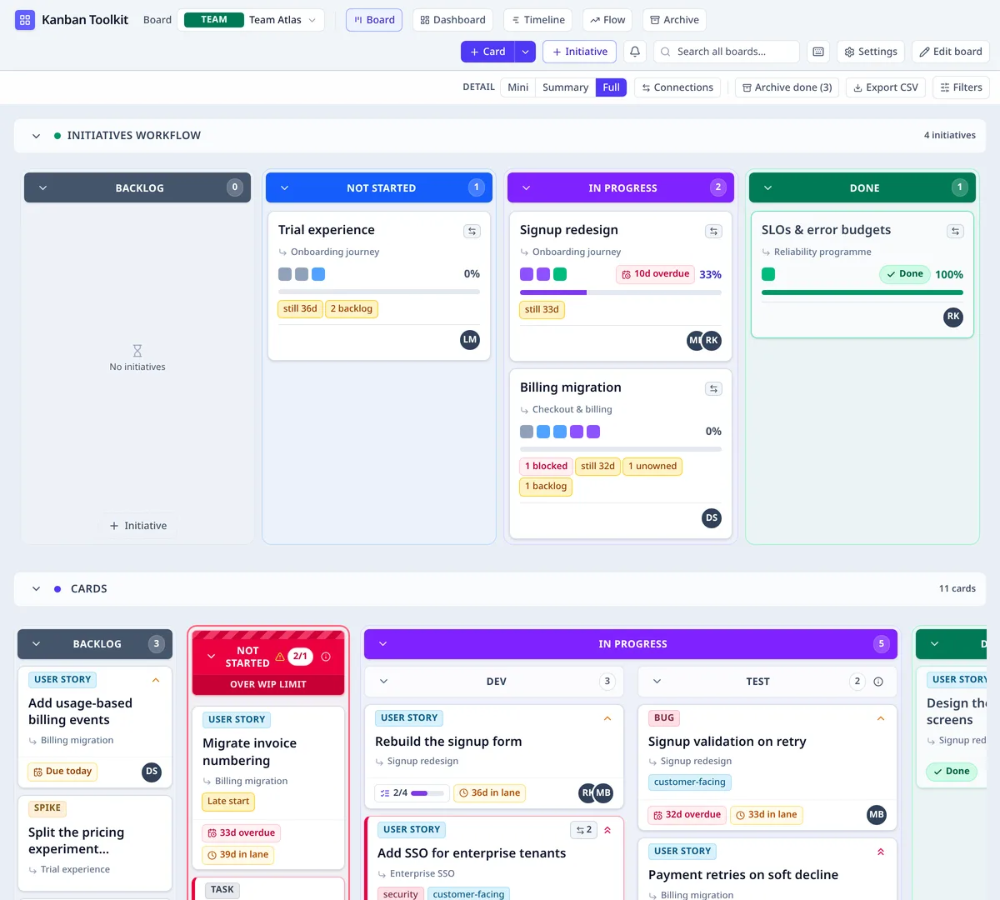
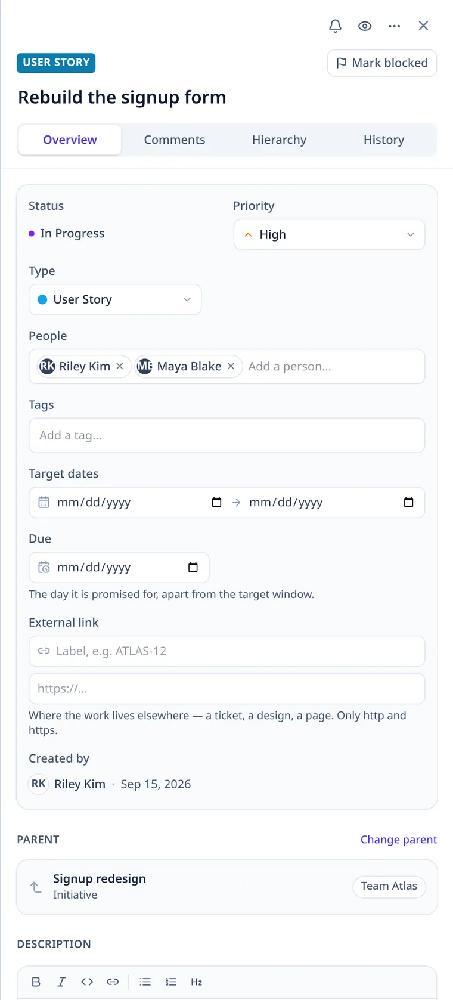
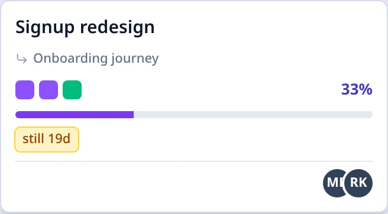
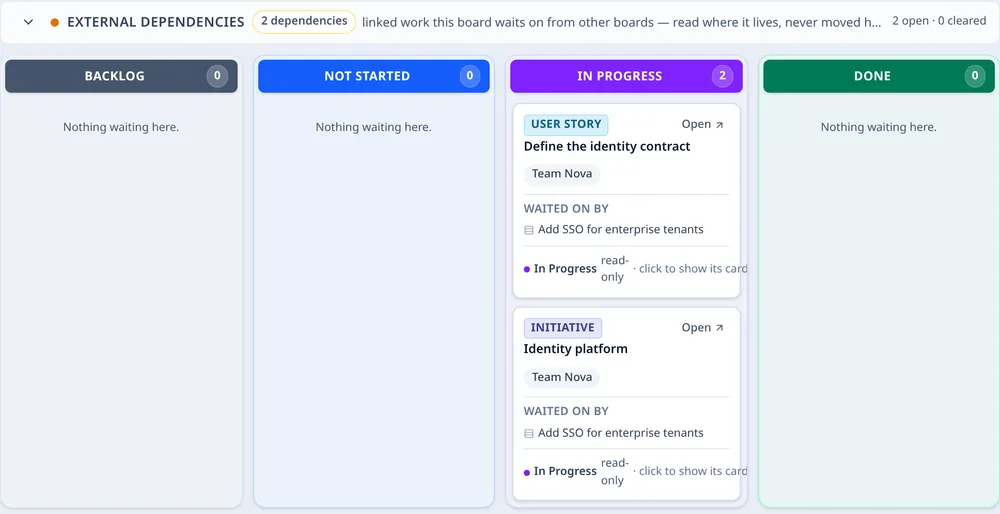

# Reading a board

A board has columns, one or more cards flows, initiatives that roll work up, a side drawer for the
detail, and external dependencies for work that lives somewhere else. This page explains what each part shows.

*The two altitudes on one board: the initiatives flow above, the team's Cards flow beneath, both
using Backlog, Not Started, In Progress and Done.*

## The four top-level columns

Every flow has the same four top-level columns, and they are fixed:

| Column | Stage | What it means |
| --- | --- | --- |
| **Backlog** | `backlog` | Work that is not committed yet. |
| **Not Started** | `notStarted` | Work the team has committed to but not begun. |
| **In Progress** | `inProgress` | Work somebody has started. |
| **Done** | `done` | Work that is finished. |

The column is the card's status. There is no separate status field to keep in step: moving a card
into a column is what changes its stage, and a card that leaves Done is open again. The same four
stages are the sections of the initiatives flow, so a card and the outcome above it are read in the
same vocabulary.

A column can be **split** into named cells, arranged in columns or rows. Every cell stays in the
stage of the column it came from, so a split makes the board more precise without inventing a fifth
stage. The top-level columns themselves are not added, removed or reordered.

## Level of detail

Every board has a **Detail** dial in its secondary bar, beside **Archive done**, **Export CSV** and
**Filters**: **Mini → Summary → Full**.

- **Full** is the card described on this page — every field, badge and control.
- **Summary** keeps the title, type, due date and people, with the due date at the foot where Full
  puts it. It carries **no warnings**: a compact face is for reading the work, and the warning
  badges belong to Full, where each has room to say what it means. The description, tags,
  checklist, links, parent, age, priority, counts and warning badges are not drawn.
- **Mini** draws each item as a small colour tile in a wrapping grid: the type's colour, a red marker
  when the card is blocked, and an amber marker when it has a warning. Hovering or focusing a tile
  opens a reading card with the title and type, what it rolls up to, who is assigned (or
  **Unassigned**) and the reason behind each red or amber marker — the same words the tile's
  accessible name carries. The layer is visual only: it takes no click, and it closes on a press,
  a scroll or when focus leaves. An **external dependency** tile opens the same way, with its state,
  home board and the cards here that wait on it.

The level changes only the drawing. The same items are in the same cells, with the same counts, WIP,
filters, search, selection, drag, card menu and keyboard moves. It is remembered in this
browser per board, not in the workspace, so two people may read one board differently and a shared
link opens the reader's own choice. It is not a permission — a Viewer gets it too. **Board design
mode** always draws Full and disables the dial; Save or Cancel returns to the chosen level.

## Connections

The **Connections** toggle in the secondary bar draws the board's relationships over the work:

- **Hierarchy** — a parent → child decomposition edge, as a solid blue string with a circle where
  it leaves the parent and an arrow at the child.
- **Dependency** — a waiting item → blocker link, as a solid red string with a circle where it
  leaves the waiting item and an arrow at the blocker. Read it as **“this (circle) waits on that
  (arrow)”**.

Strings leave the source near its bottom-left corner, inside the card rather than on the border,
and land just inside the target's nearest edge. Several strings on one card fan out from the same
start, so two children or two dependents never draw over one another.

A card's drawer has a **Connections** button. It narrows the lens to that item's own strings — its
parent and children, and any blocker or dependent either way — while the board stays whole. Closing
the drawer or opening another board ends that item reading; the board-wide toggle still controls
every string on the board.

Only edges with **both ends rendered on this board** are drawn. A card that is archived, filtered
out or in a folded flow has no element to connect to; attribution to an objective is not a
card-to-card edge. An **external dependency** link is included: it is the same dependency string,
running from the card here that waits to the external dependency card below — circle on the waiting
card, arrow on the external card — so the external dependencies band is the same graph seen at its
edge. The strings sit above the workflow headers, never take a click, and are `aria-hidden` — the
dependency counts, the external dependency cards and the drawer already say the same relationships
in words.

The view is off by default and is remembered in this browser per board; it is a reading, not a
permission or workspace data. Turning it off leaves every card and placement untouched.

## Multiple cards workflows

A board has exactly **one initiatives flow** and **one or more cards flows**.

- Each cards flow is its own set of the four columns, with its own name, its own WIP limits and its
  own place in the stack. The flows are drawn as bands, one below another, not as tabs. Two columns
  named Backlog can then be seen to mean different things.
- A card belongs to exactly one cards flow. Dragging it into another flow is a move: the target
  flow's columns and WIP limits apply, and the card keeps its identity and history.
- **Edit board** is where a cards flow is added, renamed, reordered or removed. A flow can only be
  removed while it is empty, and while another cards flow remains.
- The board's **default drop cell** and its **WIP enforcement** are board-wide, so a new card or a
  card moved from elsewhere lands consistently wherever it came from. The Flow view can be narrowed
  to one cards flow, and to one card type within it.
- A **template** captures a set of cards flows — their names, columns and limits — and a new board
  made from it gets all of them. A program or portfolio board has no cards flow of its own.

Each flow's header stays on screen while its columns scroll, so a reader in a long lane keeps the
flow, and its set of columns, in view. The initiatives and external dependency bands behave the same
way. A cards
flow lines up with the bands above and below it, and a wide flow takes the width its columns need.

A workflow's chevron folds that whole band away to its header: the name, the count and the controls
stay, and the columns give their room to the workflow below. Opening it brings the header to the top
and the columns back underneath, so the band opens where you are looking. The initiatives, cards and
external dependency bands each fold on their own, and the state is a view choice rather than an edit.

Every column folds too, at any depth: a top-level column becomes a narrow rail, and a subcolumn such
as Dev or Test under In Progress becomes its own rail. A folded rail keeps its name, count and stage
accent, and expanding it gives the cards back.

Each workflow can also carry an optional line under its name — what the workflow is for, in the
board's own words. In **Edit board** the line is edited in place beside the name: Enter or a click
away saves it, Escape reverts, and the clear control removes it. A workflow with no line shows only
its name and count.

## The side drawer

Clicking a card or an initiative opens the **side drawer** on the right; the board stays visible
beside it. The same drawer opens from search, the dashboard, the timeline and the archive.

- **Overview** holds the fields: title, description (a rich editor with a formatting toolbar and
  Markdown shortcuts), status, priority, type, people, tags, target dates, due date, an external
  link and the checklist. The description formats in place and still stores Markdown; typing `# `,
  `- `, `1. `, `**bold**` or `` `code` `` formats as it is typed. The target dates are the plan a management surface reads; the
  due date is the one day the work is promised for, and it is the date the **Overdue** and **Due soon**
  filters and every late badge speak about. A passed due date is never a block: it is a chip, and it
  clears when the day is moved or the work is done.
- **Hierarchy** shows the parent, the work below, and dependencies. A dependency links two items and
  says one waits for the other. It runs **across** the hierarchy, never along it: a card cannot wait on
  its own parent or on anything below it. A link that would close a loop is refused rather than
  corrected. The picker is a searchable list that offers only the items the link would be accepted
  for: active work. An archived or discarded item is not offered as a dependency, and an archived item
  cannot be given one. The parent picker follows the same rule — only active initiatives are parents.
  A dependency is a plan, not a block. It never stops a move, and it clears itself when the item it
  waits on reaches Done.
- **Comments** is the conversation about the item; write at the bottom of that tab. A comment is
  Markdown and `@` mentions a teammate.
- **History** is the item's own record of changes: every move, edit, block and link, with who and
  when. Comments stay in Comments rather than being mixed into the record.

Opening a card also brings it into view: the board scrolls the card into the middle of what is left
beside the drawer, so its column and neighbours are in front of the reader. A card already in view is
left where it is.

The drawer is where editing happens. If somebody else is editing the same card, the drawer shows who has
it, and the fields stay closed to you until they finish. A Viewer, and an archived or discarded item,
are read-only. A Viewer can still comment in **Comments**, but an archived item accepts no edits or
comments.

The **Connections** button in the drawer narrows the board's connection lens to this item's own
strings. Opening an item does not start that reading — the button is the way in — and an archived
item does not offer it.

People are chosen from the workspace's own directory, shown with their photo or their initials. Typing
a name searches that directory. The picker never creates a person, because an account arrives by
invitation. <kbd>Escape</kbd> closes the drawer.

*The drawer is the card's own page beside the board: fields in Overview, the conversation in
Comments, lineage in Hierarchy and the record in History.*

## What an initiative shows

An initiative is the outcome above the cards. It has no status field and no estimate of its own:
its status is read from the leaves below it, and its size is the number of those leaves.

*An initiative card: the pips are its direct children, the percentage is the share of leaves done,
and the roll-up label says what it rolls up to.*

### Card pips

The small coloured squares across an initiative card are its **direct children**, one pip each, in
the order of the four stages. The colour is the child's own stage — green for Done, violet for In
Progress, blue for Not Started, grey for Backlog.

- A pip is a way into that child: clicking it opens the child and, on a board, brings it into view.
- Pips are direct children, not every descendant. The work beneath a child is behind that child's
  own card.
- Up to 12 pips are drawn; beyond that a **+N** says how many more there are. The count includes
  filed-away children, because the rollup counts them too.

### The progress bar

The percentage and the bar beside the pips are the same number: the share of the **leaf issues
below** the initiative that are done. Every leaf counts once — however many levels of decomposition
sit above it — and an archived leaf still counts, so filing away finished work does not lower a
parent's progress.

The denominator is all the leaves, including those still in Backlog, so planning more uncommitted
work moves the percentage back. A Backlog leaf does not drag the initiative's *status* backwards, but
it does count in the percentage. An initiative with nothing below it has no percentage and no bar,
which is a different fact from 0%. **Done** on the card means every leaf below is done.

### Roll-up and automatic movement

An initiative's **section** is derived from the same rollup:

| The leaves below | The initiative reads as |
| --- | --- |
| Every leaf Done | **Done** |
| Anything started | **In Progress** |
| Nothing started, but something committed | **Not Started** |
| Everything still in Backlog, or nothing below | **Backlog** |

The initiative therefore moves between **Backlog / Not Started / In Progress / Done** by itself when
the work below changes. You do not drag it across a section boundary; dragging arranges it *within*
its section, and a move that would cross a section is refused because the work, not the placement,
decides the section. If its saved cell belonged to another section, the board draws it in the derived
section rather than in the wrong column.

A parent is a hierarchy edit, not a way off the board: an initiative that is given a parent on the
same board keeps its own card and the cell it was arranged in, and the parent's pips count it among
their children.

## External dependencies — linked work from other boards

Some work waits on something that lives on **another board**. The **External dependencies** section
below the cards is where that edge is read.

*The section is a lens over external work: the item is shown in the stage its own rollup gives it,
and the cards here that wait on it are named beside it.*

- It appears only when at least one card on this board depends on an item placed on another board.
- The external item is shown in the column its **own rollup** selects, on its own home board. It is
  not copied or moved here, and it is not a placement: it creates no WIP, no card count and no
  rollup on this board.
- Each entry names the home board, its state, and the cards here that wait on it. A card that waits
  wears a chain-link badge with the number of its open dependencies — here or on another board; the
  card's panel names them. Selecting that badge opens the card's **Hierarchy** tab and scopes the
  **Connections** lens to that item. Selecting a dependency card highlights its dependents.
- External dependency cards follow the board's **Detail** level: **Full** names the dependent
  cards, **Summary** keeps the type, title, home board and dependent count, and **Mini** is a
  type-coloured tile. Selection and the **linked** badge work at every level.
- Selecting an external dependency card — the one wearing the **linked** badge — draws the same
  dependency string the Connections lens draws for each open link: from the card here that waits to
  the external card, with the circle on the waiting card and the arrow on the external card. It also
  highlights those dependents. Nothing is drawn at rest, and the string is a reading aid, not a
  control. A satisfied or closed link keeps its entry in the band but has no string, because the
  work is no longer waiting.
- The section is a **lens**, not an editor: nothing can be dragged into it, and the only way to move
  the external work is to open it on the board that owns it.

The entries have four states, used to order and count the band. The state is not repeated as a badge
on every card: being in the external dependencies workflow already says the work is a dependency.

| State | What it means |
| --- | --- |
| **Open · live blockage** | A card here has started and the external item is not done. It is the loudest state. |
| **Open · planning risk** | A card here is still Backlog and the external item is not done. It is a risk to the plan, not a live stop. |
| **Satisfied** | The external item is done; the card here has not finished yet. |
| **Closed** | The card here is done. |

A cleared entry stays in the workflow after it is satisfied or closed, so a reader can see what the
board was waiting for last week. The dependency count on a card drops as each link is no longer open,
and disappears when none are; the workflow keeps the history. The header counts what is **open** and
what has been **cleared**.

## Related

- [Board types](board-types.md) — team, program and portfolio boards, and what each is for.
- [Warnings and signals](warnings.md) — every badge and warning, and what it means.
- [Using the application](using.md) — the board, a card, an initiative and the views.
