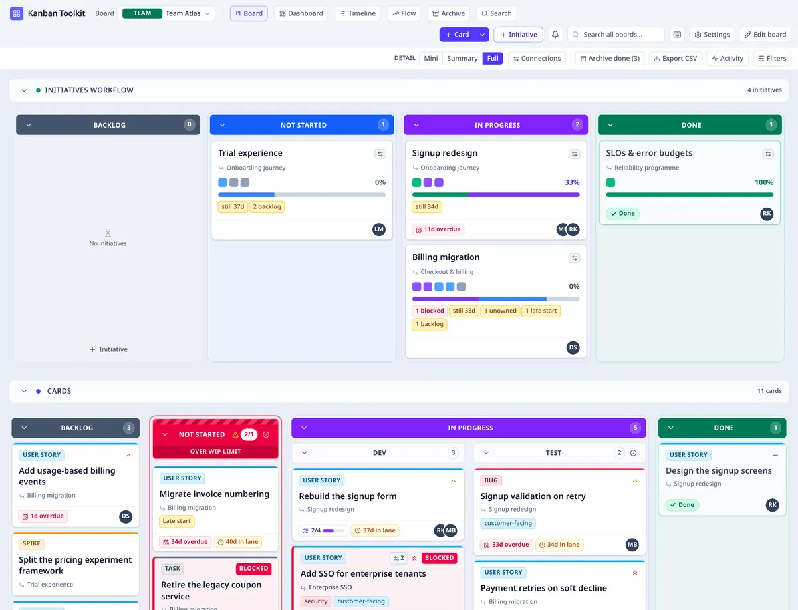
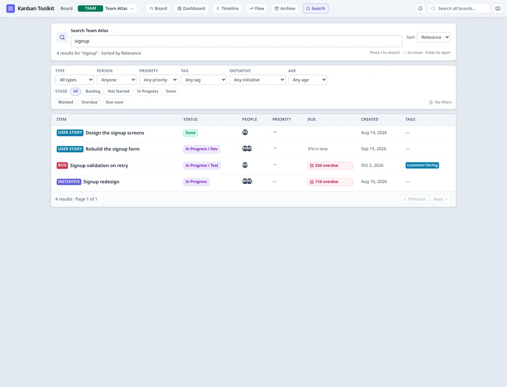
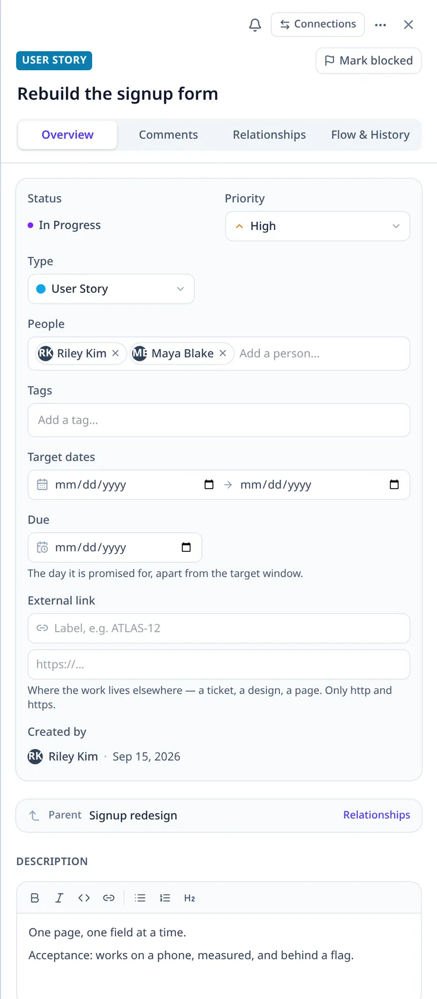
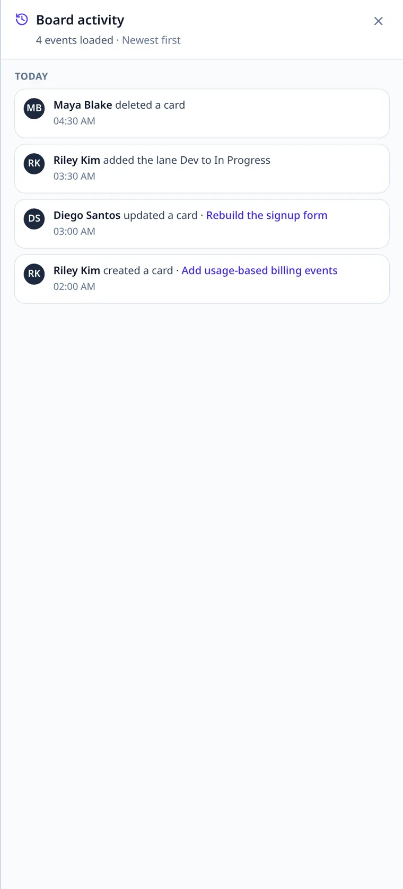
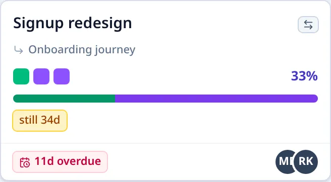
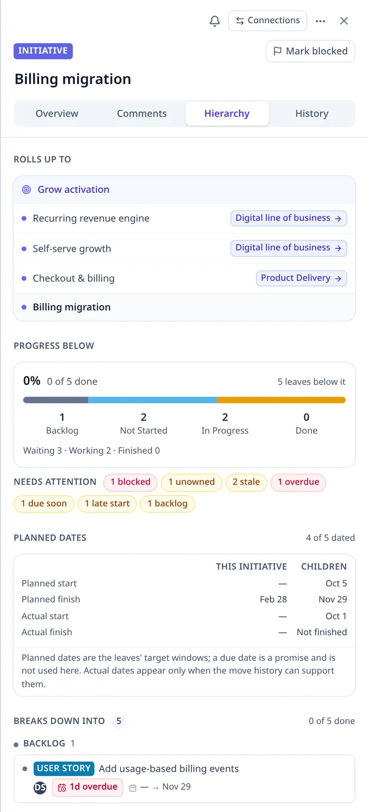
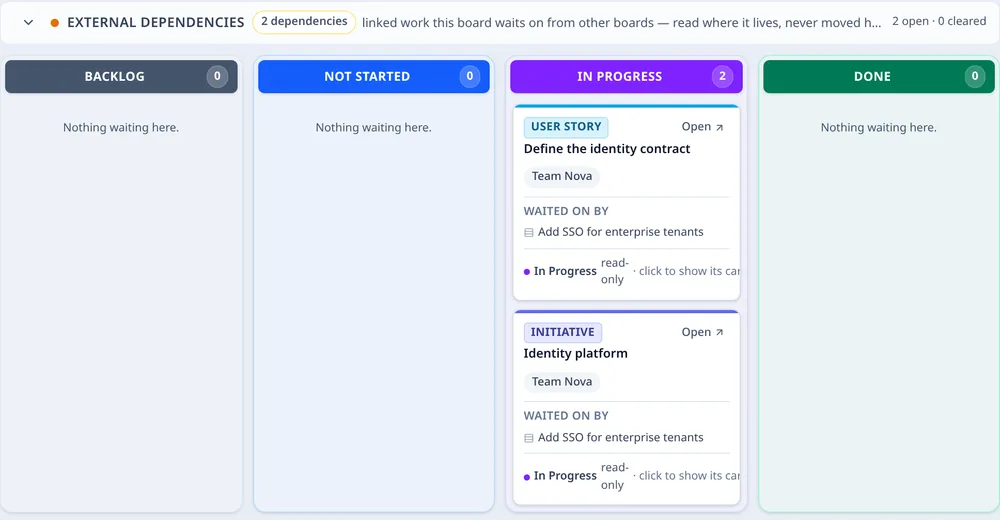

# Reading a board

A board has columns, one or more cards flows, initiatives that roll work up, a side drawer for the
detail, and external dependencies for work that lives somewhere else. This page explains what each part shows.

*The two altitudes on one board: the initiatives flow above, the team's Cards flow beneath, both
using Backlog, Not Started, In Progress and Done.*

## The four top-level columns

Every flow has the same four top-level columns, and they are fixed:

| Column | Stage | What it means |
| --- | --- | --- |
| **Backlog** | `backlog` | Work that is not committed yet. |
| **Not Started** | `notStarted` | Work the team has committed to but not begun. |
| **In Progress** | `inProgress` | Work somebody has started. |
| **Done** | `done` | Work that is finished. |

The column is the card's status. There is no separate status field to keep in step: moving a card
into a column is what changes its stage, and a card that leaves Done is open again. The same four
stages are the sections of the initiatives flow, so a card and the outcome above it are read in the
same vocabulary.

A column can be **split** into named cells, arranged in columns or rows. Every cell stays in the
stage of the column it came from, so a split makes the board more precise without inventing a fifth
stage. The top-level columns themselves are not added, removed or reordered.

## Level of detail

Every board has a **Detail** dial in its secondary bar, beside **Archive done** and **Filters**:
**Mini → Summary → Full**.

- **Full** is the card described on this page — every field, badge and control.
- **Summary** keeps the title, type, due date and people, with the due date and people in the same
  footer band Full uses. An initiative also keeps its **progress bar** and percentage, because that
  reading is what the summary is for. It carries no **warning words**: a small red or amber triangle
  marks that warnings exist, with their sentences in its title, and Full is where each one explains
  itself. The description, tags, checklist, links, parent, age, priority, counts and warning badges
  are not drawn.
- **Mini** draws each item as a small colour tile in a wrapping grid: the type's colour, a red marker
  when the card is blocked, and an amber marker when it has a warning. Hovering or focusing a tile
  opens a reading card with the title and type, what it rolls up to, who is assigned (or
  **Unassigned**) and the reason behind each red or amber marker — the same words the tile's
  accessible name carries. The layer is visual only: it takes no click, and it closes on a press,
  a scroll or when focus leaves. An **external dependency** tile opens the same way, with its state,
  home board and the cards here that wait on it.

Changing the Detail dial redraws the cards; it does not close the open card drawer or clear an
active card selection.

Every card ends in a **footer band**, at Full and Summary alike: the promise (due date), the link,
the checklist, the finished stamp and the people sit on one opaque strip at the foot, so the facts a
reader acts on are found in the same place on every card. A blocked card's band is rose, like its
surface; a done card's is grey; a card with nothing in its foot draws no band rather than an empty
one.

The level changes only the drawing. The same items are in the same cells, with the same counts, WIP,
filters, search, selection, drag, card menu and keyboard moves. It is remembered in this
browser per board, not in the workspace, so two people may read one board differently and a shared
link opens the reader's own choice. It is not a permission — a Viewer gets it too. **Board design
mode** always draws Full and disables the dial; Save or Cancel returns to the chosen level.

## Search: a jump and a reading

There are two searches, and they answer different questions. The field in the top bar is a **jump**:
type a word, see matches from every board, press Enter, land on the card. The **Search** tab in the
board's view switcher is a **reading**: it searches only the live work this board carries, keeps the
result set in front of you, and shows the metadata a reader needs to judge a row without opening it.

The query searches titles, descriptions, external-link labels and comments, in the same words the
top-bar finder uses. A comment the browser does not hold is asked of the server, scoped to this
board's work; a static deployment searches what it has. Archived work stays in the Archive, which has
its own search — this view reads live work only.

The board's filters narrow the result set: type, person (including **Unassigned**), priority, tag,
initiative, age and the blocked/overdue/due-soon conditions, plus a **Stage** switch for the four
columns. The table shows the title with a marked excerpt when the hit came from the description, link
or comment, then type, status, people, priority, due, created and tags. **Relevance**, **Title** and
**Newest** sort it; a page holds 50 rows. A row is a way in: the title opens the card in the side
drawer, and the search stays behind it.

The query is part of the link (`?view=search&q=…`), so back, forward and a shared URL all restore the
words. <kbd>/</kbd> focuses the search field while the view is open; <kbd>↑</kbd>/<kbd>↓</kbd> move
through the rows and <kbd>Enter</kbd> opens the one in front. Typing words in the top-bar finder and
choosing **Search this board for “…”** hands the query to this view.

*The review table: the board's own live work, its filters, and the metadata that lets a row be
judged before it is opened.*

## Connections

The **Connections** toggle in the secondary bar draws the board's relationships over the work.
Turning it on or off is a reading of the board, not a click away from the card being read: it does
not close the open drawer or clear a selection.

It draws the board's relationships over the work:

- **Hierarchy** — a parent → child decomposition edge, as a solid blue string with a circle where
  it leaves the parent and an arrow at the child.
- **Dependency** — a waiting item → blocker link, as a solid red string with a circle where it
  leaves the waiting item and an arrow at the blocker. Read it as **“this (circle) waits on that
  (arrow)”**.

Strings leave the source near its bottom-left corner, inside the card rather than on the border,
and land just inside the target's nearest edge. Several strings on one card fan out from the same
start, so two children or two dependents never draw over one another.

A card's drawer has a **Connections** button. It narrows the lens to that item's own strings — its
parent and children, and any blocker or dependent either way — while the board stays whole. Closing
the drawer or opening another board ends that item reading; the board-wide toggle still controls
every string on the board.

Only edges with **both ends rendered on this board** are drawn. A card that is archived, filtered
out or in a folded flow has no element to connect to; attribution to an objective is not a
card-to-card edge. An **external dependency** link is included: it is the same dependency string,
running from the card here that waits to the external dependency card below — circle on the waiting
card, arrow on the external card — so the external dependencies band is the same graph seen at its
edge. The strings sit above the workflow headers, never take a click, and are `aria-hidden` — the
dependency counts, the external dependency cards and the drawer already say the same relationships
in words.

The view is off by default and is remembered in this browser per board; it is a reading, not a
permission or workspace data. Turning it off leaves every card and placement untouched.

## Multiple cards workflows

A board has exactly **one initiatives flow** and **one or more cards flows**.

- Each cards flow is its own set of the four columns, with its own name, its own WIP limits and its
  own place in the stack. The flows are drawn as bands, one below another, not as tabs. Two columns
  named Backlog can then be seen to mean different things.
- A card belongs to exactly one cards flow. Dragging it into another flow is a move: the target
  flow's columns and WIP limits apply, and the card keeps its identity and history.
- **Edit board** is where a cards flow is added, renamed, reordered or removed. A flow can only be
  removed while it is empty, and while another cards flow remains.
- The board's **WIP enforcement** is board-wide, so a card moved from elsewhere follows the policy
  of the column it lands in. A new card is made from a workflow's own Backlog, or from the toolbar
  with its workflow chosen. The Flow view can be narrowed to one cards flow, and to one card type
  within it.
- A **template** captures a set of cards flows — their names, columns and limits — and a new board
  made from it gets all of them. A program or portfolio board has no cards flow of its own.

Each flow's header stays on screen while its columns scroll, so a reader in a long lane keeps the
flow, and its set of columns, in view. The initiatives and external dependency bands behave the same
way. A cards
flow lines up with the bands above and below it, and a wide flow takes the width its columns need.

A workflow's chevron folds that whole band away to its header: the name, the count and the controls
stay, and the columns give their room to the workflow below. Opening it brings the header to the top
and the columns back underneath, so the band opens where you are looking. The initiatives, cards and
external dependency bands each fold on their own, and the state is a view choice rather than an edit.

Every column folds too, at any depth: a top-level column becomes a narrow rail, and a subcolumn such
as Dev or Test under In Progress becomes its own rail. A folded rail keeps its name, count and stage
accent, and expanding it gives the cards back.

Each workflow can also carry an optional line under its name — what the workflow is for, in the
board's own words. In **Edit board** the line is edited in place beside the name: Enter or a click
away saves it, Escape reverts, and the clear control removes it. A workflow with no line shows only
its name and count.

## The side drawer

Clicking a card or an initiative opens the **side drawer** on the right; the board stays visible
beside it. The same drawer opens from search, the dashboard, the timeline and the archive.

- **Overview** holds the fields: title, description (a rich editor with a formatting toolbar and
  Markdown shortcuts), status, priority, type, people, tags, target dates, due date, an external
  link and the checklist. The description formats in place and still stores Markdown; typing `# `,
  `- `, `1. `, `**bold**` or `` `code` `` formats as it is typed. The target dates are the plan a management surface reads; the
  due date is the one day the work is promised for, and it is the date the **Overdue** and **Due soon**
  filters and every late badge speak about. A passed due date is never a block: it is a chip, and it
  clears when the day is moved or the work is done.
- **Relationships** shows the parent, the work below, and dependencies. For an initiative it opens with a
  reading of the work below — progress, the four stages, the risks the health and attention rules
  find, and the planned and actual dates — before the direct children. A flag chip narrows the child
  list to the branches that carry it, with **All children** to reset. A card's Relationships shows its
  own chain and dependencies as before. A dependency links two items and
  says one waits for the other. It runs **across** the hierarchy, never along it: a card cannot wait on
  its own parent or on anything below it. A link that would close a loop is refused rather than
  corrected. The picker is a searchable list that offers only the items the link would be accepted
  for: active work. An archived or discarded item is not offered as a dependency, and an archived item
  cannot be given one. The parent picker follows the same rule — only active initiatives are parents.
  A dependency is a plan, not a block. It never stops a move, and it clears itself when the item it
  waits on reaches Done.
- **Comments** is the conversation about the item; write at the bottom of that tab. A comment is
  Markdown and `@` mentions a teammate.
- **Flow** is the drawer's reading of time, and it sits at the top of the **Flow & History** tab rather than in
  Overview: a card's overview stays about its fields. It is derived from the card's own moves, not
  from a field somebody keeps up to date. Three numbers lead: **Open** (or **Lead** once the card
  has stopped), **Cycle** from the first commitment, and the current cell — or
  **Delivered**/**Filed** with the day it stopped. Below them the same section draws the stage bar
  and rows: the scope, the waiting/working/finished split, blocked time in detail, the last move,
  the board's p85 when the sample can carry it, and the caveat when the log begins after creation.
  A delivered card's clocks stop at delivery and a filed card's at the archive. The drawer reads
  the whole log, not its first page, so an age is never under-reported behind a shorter page.
  An initiative has **no cycle of its own**: its section and progress are derived from the leaves.
  Its Flow section, at the top of **Flow & History**, shows **Progress**, **Leaves done** and **Open** as
  three numbers, then the distribution of its leaves, the oldest open leaf, and one quiet line for
  blocked/waiting/unowned work or the last movement of its children. When the child history is not loaded it says
  **Movement not loaded** rather than treating the initiative's creation as a movement, and there
  is deliberately no section-age clock until the work below can support one.
- **Flow & History** is the item's own record of changes: every move, edit, block and link, with
  who and when. The **Flow** section at the top draws the time reading, with the stage breakdown for
  a card; Comments stay in Comments rather than being mixed into the record.

Opening a card also brings it into view: the board scrolls the card into the middle of what is left
beside the drawer, so its column and neighbours are in front of the reader. A card already in view is
left where it is.

The drawer is where editing happens. Opening a card takes its pen, so a card somebody has open is
locked to everybody else: the drawer shows who has it, and the fields stay closed to you until they
close it. You can still read it and move it around the board. A Viewer, and an archived or discarded
item, are read-only. A Viewer can still comment in **Comments**, but an archived item accepts no
edits or comments.

The **Connections** button in the drawer narrows the board's connection lens to this item's own
strings. Opening an item does not start that reading — the button is the way in — and an archived
item does not offer it.

People are chosen from the workspace's own directory, shown with their photo or their initials. Typing
a name searches that directory. The picker never creates a person, because an account arrives by
invitation. <kbd>Escape</kbd> closes the drawer.

*The drawer is the card's own page beside the board: fields in Overview, the conversation in
Comments, lineage in Relationships and the Flow reading and record in Flow & History.*

## Board activity

**Activity** in the board's secondary bar opens the board's own stream on the right. It is a
reading of the board, not a second copy of a card: a card made, changed or deleted, and a change to
the board's design or workflows, in one list with who did it and when. A card's many changes are
one **updated** row rather than a field-by-field diary — that detail belongs to the card's own
**Flow & History** tab — and a card still on this board is a link into its drawer. A card that has since left
the board is named in place without a link; a **deleted** card leaves the event and nothing else:
no title, no assignee, no snapshot, and its earlier rows lose the reference too. Board design
changes read as a sentence — a lane split, a workflow added, a WIP policy changed.

Events are grouped by the day they happened and read newest first; **Load earlier activity** pages
back. One side panel is open at a time: opening Activity closes an open card, Filters or My work,
and opening a card from Activity replaces it with that card. A board made before this stream
existed starts empty and says so, pointing at each card's Flow & History tab rather than inventing events.

*The board stream beside the work: card changes summarise as updated, a design change is a
sentence, and a deleted card is never named.*

## What an initiative shows

A card becomes an initiative from its card menu (**Convert to initiative**). It is the same item —
the same id, people, tags, links, comments, dependencies, parent and history — wearing the reserved
Initiative type; the card type it gave up is named in its history. Its placement leaves the cards
flow for the initiatives flow's section of its stage, and its kind is left unset for a person to
choose. One card at a time, and only where the board has an initiatives cell.

An initiative is the outcome above the cards. It has no status field and no estimate of its own:
its status is read from the leaves below it, and its size is the number of those leaves.

*An initiative card: the pips are its direct children, the percentage is the share of leaves done,
and the roll-up label says what it rolls up to.*

### Card pips

The small coloured squares across an initiative card are its **direct children**, one pip each, in
the same order as the progress bar below them: **Done** (green), **In Progress** (violet), **Not
Started** (blue), then **Backlog** (grey), so the state of the work reads left to right.

- A pip is a way into that child: clicking it opens the child and, on a board, brings it into view.
  If the child's workflow band or a column above its cell is folded, opening the pip unfolds it so
  the card is there to be seen.
- Hovering a pip shows a small reading of that child without opening it: its status, title, type, kind and
  priority, people, deadline, tags, and the board, workflow and column it sits in. The reading is visual only — it takes no click and closes
  when the pointer leaves; the initiative's own panel remains the keyboard path to every child.
- Pips are direct children, not every descendant. The work beneath a child is behind that child's
  own card.
- A blocked child's pip **becomes** a rose alert box with a centred ban mark; a child with a
  warning — overdue, due soon, late to start, stale, unowned in progress, or an initiative flag —
  becomes an amber box with a warning triangle. Risk supersedes the stage colour on that pip: the
  shape says "look here" first, and the hover reading still names the stage. A blocked child shows
  the blocked box even when it also has another warning, and the pip's accessible name says which
  it is. Hovering puts the blocker reason and the **Warnings** section directly under the title, before
  the card's facts, so the reason a pip is alerting comes first; both use the same words as the
  child's card.
- Up to 12 pips are drawn; beyond that a **+N** says how many more there are. Completed filed-away
  children still count, because their work is part of what was delivered; a discarded child is not
  drawn as a progress pip, and the drawer lists it with its discarded outcome. The initiative card
  does not repeat the count on its face.

### The progress bar

The percentage and the bar beside the pips are the same number: the share of the **leaf issues
below** the initiative that are done. The bar itself keeps the whole answer, not only the
finished share: its segments are **Done**, **In Progress**, **Not Started** and **Backlog**, in the
order a reader moves through the work, and every segment is the leaves in that stage. Every leaf
counts once — however many levels of decomposition sit above it — and an archived leaf that was
completed still counts, so filing away finished work does not lower a parent's progress.
**Discarded** leaves are not in the counts at all — thrown away, not a plan that remains unfinished
— so they cannot flatter the bar or the percentage. The bar's title and accessible name carry every
count. The same bar, in the same order and the board's stage colours, is drawn on the card face, at
**Summary**, and under the drawer's **Relationships** tab.

The due date, external link, **Done** stamp and people sit in the footer band, as they do on a card.
The progress bar above is the initiative's own reading; the footer is what a reader can act on.

The denominator is all the leaves, including those still in Backlog, so planning more uncommitted
work moves the percentage back. A Backlog leaf does not drag the initiative's *status* backwards, but
it does count in the percentage. An initiative with nothing below it has no percentage and no bar,
which is a different fact from 0%. **Done** on the card means every leaf below is done.

### The Hierarchy reading

An initiative's **Relationships** tab opens with a reading of the work below, before the direct children.
It is the same model every other surface reads, not a second tracker:

- **Progress below** shows the leaf count, the four stage counts, the percentage and the
  `done of total` count, with a bar that carries no meaning on its own — the numbers beside it do.
  **Waiting** is Backlog plus Not Started, **Working** is In Progress, and **Finished** is Done.
- **Needs attention** carries the risks among the leaves: blocked, waiting, unowned, stale, overdue,
  due soon, late start, still-uncommitted Backlog work, and discarded work. A chip is a way to
  narrow the direct children to the branches that carry it; **All children** restores the list. The
  counts are the rules' own counts, so the Overview warning row, the card badges and this summary
  cannot disagree.
- **Planned dates** is the envelope over the leaves' target windows: the earliest target start and the
  latest target finish, beside the initiative's own target start and end. If only some leaves carry a
  date the panel says so — `8 of 12 dated` — rather than implying the envelope is complete. A due date
  is a promise; it is never used as a plan date.
- **Actual start** and **Actual finish** appear only when the move history can support them. The start
  is the earliest commitment among the leaves; a leaf that never left Backlog has not started, and a
  history that was not loaded says **Not loaded** rather than inventing a date. The finish is shown
  only when every leaf is done and every one carries a resolved stamp; otherwise it says **Not
  finished**.

*The hierarchy reading: the leaves' progress, the risks they carry, and the plan beside the work.
The direct children stay below, and a flag narrows them to the branch that carries it.*

### Roll-up and automatic movement

An initiative's **section** is derived from the same rollup:

| The leaves below | The initiative reads as |
| --- | --- |
| Every leaf Done | **Done** |
| Anything started | **In Progress** |
| Nothing started, but something committed | **Not Started** |
| Everything still in Backlog, or nothing below | **Backlog** |

The initiative therefore moves between **Backlog / Not Started / In Progress / Done** by itself when
the work below changes. You do not drag it across a section boundary; dragging arranges it *within*
its section, and a move that would cross a section is refused because the work, not the placement,
decides the section. If its saved cell belonged to another section, the board draws it in the derived
section rather than in the wrong column.

A parent is a hierarchy edit, not a way off the board: an initiative that is given a parent on the
same board keeps its own card and the cell it was arranged in, and the parent's pips count it among
their children.

## External dependencies — linked work from other boards

Some work waits on something that lives on **another board**. The **External dependencies** section
below the cards is where that edge is read.

*The section is a lens over external work: the item is shown in the stage its own rollup gives it,
and the cards here that wait on it are named beside it.*

- It appears only when at least one card on this board depends on an item placed on another board.
- The external item is shown in the column its **own rollup** selects, on its own home board. It is
  not copied or moved here, and it is not a placement: it creates no WIP, no card count and no
  rollup on this board.
- Each entry names the home board, its state, and the cards here that wait on it. A card that waits
  wears a chain-link badge with the number of its open dependencies — here or on another board; the
  card's panel names them. Selecting that badge opens the card's **Relationships** tab and scopes the
  **Connections** lens to that item; selecting the same badge again closes the drawer and ends the
  reading. Selecting a dependency card highlights its dependents.
- External dependency cards follow the board's **Detail** level: **Full** names the dependent
  cards, **Summary** keeps the type, title, home board and dependent count, and **Mini** is a
  type-coloured tile. Selection and the **linked** badge work at every level.
- Selecting an external dependency card — the one wearing the **linked** badge — draws the same
  dependency string the Connections lens draws for each open link: from the card here that waits to
  the external card, with the circle on the waiting card and the arrow on the external card. It also
  highlights those dependents. Nothing is drawn at rest, and the string is a reading aid, not a
  control. A satisfied or closed link keeps its entry in the band but has no string, because the
  work is no longer waiting.
- The section is a **lens**, not an editor: nothing can be dragged into it, and the only way to move
  the external work is to open it on the board that owns it.

The entries have four states, used to order and count the band. The state is not repeated as a badge
on every card: being in the external dependencies workflow already says the work is a dependency.

| State | What it means |
| --- | --- |
| **Open · live blockage** | A card here has started and the external item is not done. It is the loudest state. |
| **Open · planning risk** | A card here is still Backlog and the external item is not done. It is a risk to the plan, not a live stop. |
| **Satisfied** | The external item is done; the card here has not finished yet. |
| **Closed** | The card here is done. |

A cleared entry stays in the workflow after it is satisfied or closed, so a reader can see what the
board was waiting for last week. The dependency count on a card drops as each link is no longer open,
and disappears when none are; the workflow keeps the history. The header counts what is **open** and
what has been **cleared**.

## Related

- [Board types](board-types.md) — team, program and portfolio boards, and what each is for.
- [Warnings and signals](warnings.md) — every badge and warning, and what it means.
- [Using the application](using.md) — the board, a card, an initiative and the views.
