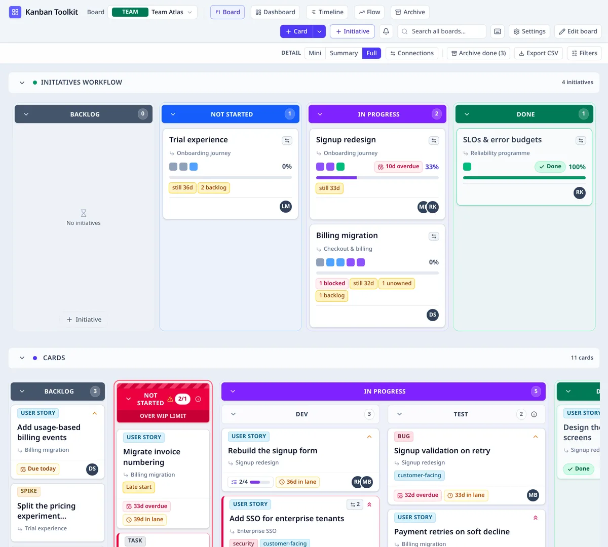
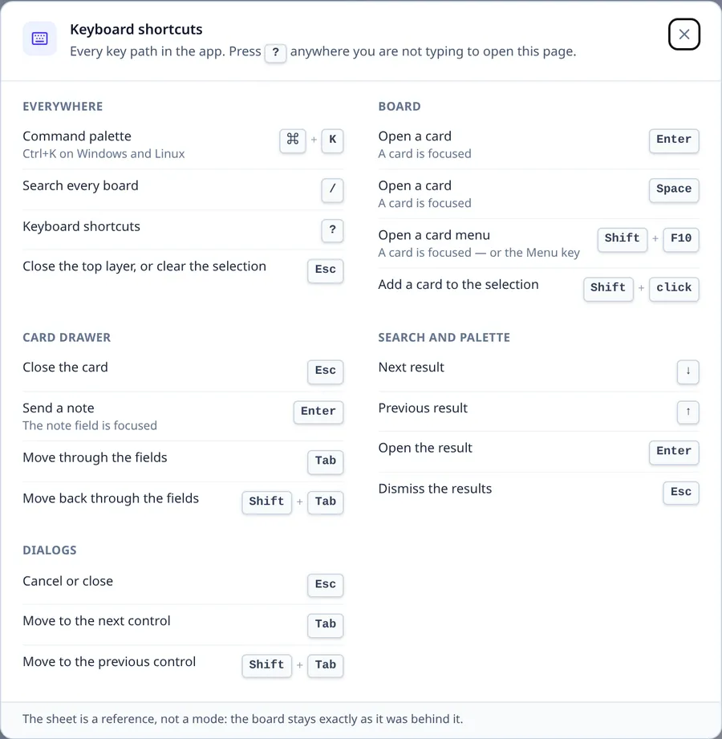
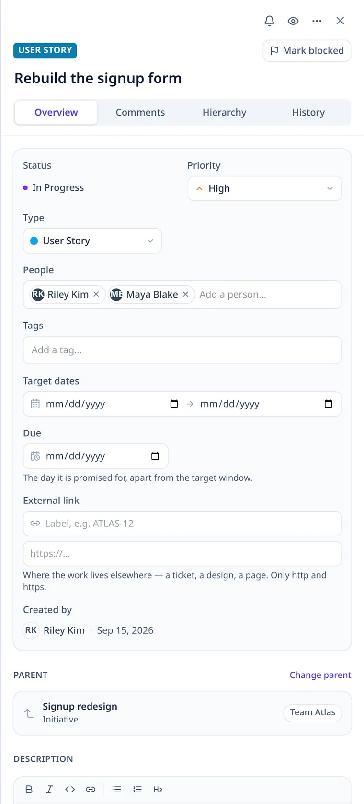
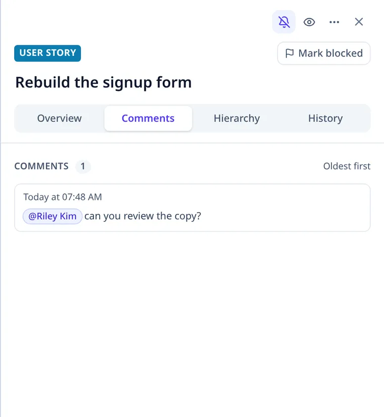

# Using Kanban Toolkit

This page covers the application from the outside: the workspace, a board, a card, an initiative, and
the views that read the same work at another altitude. [Installing it](install.md) is the other half.

## The workspace

The **Kanban Toolkit** button at the top left returns to **Workspace Home**: every board in the organisation,
grouped by type (team, program, portfolio), with a type filter and a search. **New board**
makes one. **Import board…** brings a Trello export or a Jira CSV in as one new board, with a
mapping step for lists, people and types — [Importing a board](import.md) explains the files and
what is created.

The rows above the band filter are **yours**: a star on a board card keeps it under **Favourites**,
and the boards you opened most recently sit under **Recent boards**, newest first, without repeating
a favourite. Both are this browser's — they survive a reload and follow no one to another device —
and both step aside while you search the full list or read the templates.

On a browser-only build, the browser holds the whole workspace and nothing is sent anywhere. On an
instance, the boards are shared, and signing in adds your account to the workspace's people.

The **command palette** (<kbd>Ctrl</kbd>+<kbd>K</kbd>, or <kbd>⌘</kbd>+<kbd>K</kbd>) reaches every
board, card and view, and the verbs that make them. With a card open, it also acts on that card:
assign it to yourself, move it to Done, block it with a reason, watch or unwatch it, set its due
date, or open its panel. Each verb is the same call the drawer or the card menu makes, so the board's
own rules decide — a full `block` column refuses the move with the same sentence, and a verb that
would be refused is not offered. The search field beside it searches every board by title,
description and comment, and shows the line that matched.

## A board

Every board is a **team**, **program** or **portfolio** board; [Board types](board-types.md) explains
what each level is for and when to choose it. The level is fixed when the board is made: **Settings**
shows it but does not offer to change it, because a different level would hide the work the board
already holds.

**Board settings** is a tabbed dialog. **General** holds the board’s name and description, its WIP
enforcement and the template a board design can be saved as; **Cards** its card types and its
initiative kinds, with the type new cards default to; **Tags** its tags; and **Boards** the
boards a program or portfolio reads beneath it. Only the tabs a board can act on are shown, and
changes are saved as you edit. A board’s type is fixed when it is made and is not a setting: the
dialog’s header names it, and there is nothing to change.

The **Detail** dial in the board’s secondary bar — beside **Archive done**, **Export CSV** and
**Filters** — chooses how much of a card the board draws, including an external dependency card:
**Mini** (colour tiles, with blocked and warning markers), **Summary** (title, type, the dependency
count beside it, people, and the due date at the foot — no warning badges; those are Full's to spell
out and Mini's to mark) or **Full** (the whole card). Hover or focus a Mini
tile to read the card it stands for: its title and type, what it rolls up to, who is assigned, what
it depends on, and why it has a red or amber marker. It is one person's reading, remembered in this
browser per board. It changes only the drawing: counts, WIP, filters, search, drag, the card menu and
the keyboard all work the same. **Edit board** always shows Full and disables the dial.

The same secondary bar has a **Connections** toggle. When it is on, every hierarchy edge (parent →
child, solid blue) and dependency (waiting item → blocker, solid red) between items this board
renders is drawn above the board — both with a circle at the start and an arrow at the end. A red
dependency is read from its circle to its arrow as “this waits on that”, including an external
dependency whose circle sits on the card here and whose arrow points at the external item below. It
is a reading aid: off by default, remembered in this browser per board, and it does not change the
work or intercept a click. A card's drawer adds a **Connections** button that narrows the same lens
to that item's own strings until the drawer closes or the board changes. The chain-link badge on a
waiting card is the shortcut: it opens that item's **Hierarchy** tab and turns the scoped lens on in
one press. An initiative card carries that door when it has child work or a dependency to read,
even with a count of zero; an empty initiative is left quiet.

Every board has four fixed stages: **Backlog**, **Not Started**, **In Progress** and **Done**. The
stage belongs to the column, so a card's status is never a word somebody chose; the shape inside a
stage is the team's. **Edit board** splits a column into cells, renames them, adds a lane, or removes
one. A lane is removed only while it is **empty**: deleting a column never moves a card, and a split
whose remaining cell holds cards is left as it is rather than folded over them. Any column folds to
a narrow rail, including the subcolumns of a split — Dev and Test under In Progress can be folded
independently, and expanding one gives its cards back.

*The Team Atlas demo board. The initiatives flow sits above the team's Cards flow; both read the same
four stages, and the cards' progress rolls into the initiatives above them.*

A **portfolio** board has no **Edit board** in the lane sense. Its shape comes from its objectives, which
are edited on the board itself: **Edit objectives** makes the strategy map editable and brings the
period controls, key results and re-order controls into it. Read mode stays the map of objectives and the initiatives that
serve them; its navigation is **Board** alone, because the dashboard, timeline and archive report on
work a portfolio does not hold itself.

A board carries **flows**, each a set of those four columns. It has exactly one **initiatives** flow —
where the same work is read as outcomes — and **one or more cards flows**: the team's own. Each cards
flow is a band of its own, stacked the way the initiatives flow is, with its own name, its own
columns and its own count. Two columns named Backlog can mean different things on different flows, so each
band names its flow, and a card belongs to exactly one of them.

In **Edit board** a cards flow can be added (**Add a cards flow**), renamed, moved up or down, and
removed — but only while it is empty and another cards flow remains, so a board never drops to none
and work is never thrown away with a column set. A program or portfolio board aggregates other
boards and has no cards flow of its own. While **Edit board** is open the board switcher is disabled;
the workspace-home link asks before leaving, because leaving would discard the unsaved design.

A workflow's chevron folds its whole band away to the header, keeping the name and count in view;
the initiatives and external dependency workflows fold the same way. Opening a folded band brings its header to
the top and puts the columns back underneath it, rather than above the fold. Folding is a view
choice, not an edit, so it is offered without **Edit board**.

Each workflow can carry an optional line under its name — what it is for. In **Edit board** the field
sits beside the name; leave it empty and the workflow shows only its name and count.

The drawer, card pips, initiative rollups and external dependencies are explained in [Reading a board](reading-a-board.md).

A card is made in a **Backlog** column's footer (**Add card to …**) or from **Card** in the
toolbar. When the board has more than one cards workflow, the arrow beside **Card** names the flow
the card belongs to; choosing a flow also makes the card there. An initiative is made in the
initiatives workflow's Backlog footer (**Initiative**) or from **Initiative** in the toolbar. Drag a card to
another cell to move it — including into another cards flow, where the target flow's WIP limit
applies. A column can carry a **WIP limit**; **Settings** decides what a limit does — mark the column with
hazard tape and the words (**visualize**), hold the move until a reason is given (**justify**), or
refuse it (**block**) — and that policy covers every cards flow on the board.

The keyboard reaches everything. Focus a card and press
<kbd>Shift</kbd>+<kbd>F10</kbd> for its menu — **Move to lane**, **Move earlier**, **Move later**,
**Set parent…** — and <kbd>Enter</kbd> to choose. <kbd>Escape</kbd> closes a panel and gives the focus
back. Press <kbd>?</kbd> anywhere you are not typing — or choose **Keyboard shortcuts** in the command
palette — for the full sheet, grouped by where each key works.

*The shortcut sheet: every key path, grouped by where it works.*

## A card

Choose a card to open its panel. **Overview** holds the title, the description (a rich editor with a
formatting toolbar), status, priority, type, people, tags, target dates, the day the work is due and
an external link to where the work lives elsewhere; the creator is recorded and is not editable.
Select words in the description and the toolbar formats them in place — bold, italic, inline code, a
link, a list or a heading — while the field still stores Markdown. Markdown shortcuts work as you
type too: `# ` starts a heading, `- ` or `1. ` a list, and `**bold**`, `*italic*` and `` `code` ``
are recognised as they close. **Comments** is the conversation about the card, with the composer at
the bottom of that tab; **Hierarchy** shows the parent and the work below; **History** is the card's
record of changes — every move, edit, block and link, with who and when.

*The side drawer, with the board still behind it: the fields in Overview, the conversation in
Comments, the parent in Hierarchy and the changes in History.*

A comment is written at the bottom of **Comments**, and typing `@` offers a teammate to mention.
Mentions are flat: there are no replies and no threads. The person is recorded on the comment and
shown as a pill in the sentence, and the comment appears under **Mentions** in **My work** — the
place that brings a mention back to the person it names.

*A mention is part of the comment: the name stays in the sentence as a pill, and the person it means
is recorded on the entry.*

The checklist holds the card's sub-tasks. A card can wait on another: the waiting state is read from
the two ends, so it clears when the blocker reaches Done — there is nothing to update by hand.
**Mark blocked** records a reason when the work is stopped for something that is not another card.

The bell in **Overview** watches the card. A watch is one person's interest in one piece of work —
the creator, each person assigned and whoever writes a comment join without asking. A watch starts
when you make it: the card's earlier record stays in **History**, not in the inbox; only what happens
next is news. Watching is not a permission: a Viewer can watch
too. The **bell in the top bar** opens the inbox, newest first: what changed on the work you watch,
with the board and column, and a row opens the card where it lives. **Mark all read** moves the
cursor. An instance keeps the watch
list and the cursor with the account; a static build keeps both in this browser, and the panel says
so. Notifications are only ever about cards and initiatives you watch — there is no board or filter
subscription. A person may also turn email on in **Your profile → Email delivery**, choosing *as it
happens*, *daily* or *weekly*; one plain-text message per period carries the changes, assignments,
mentions, due work and watched initiatives at risk, with a link that stops it. Email is only offered
when the operator configured a relay.

Every badge a card, initiative or objective can carry is catalogued in [Warnings and signals](warnings.md),
with what raises it and what clears it.

## Initiatives

An initiative is the unit the wider organisation reads. It has no estimate and no status field: its
status is the rollup of the cards below it, and its percentage is the share of those cards that are
done.

Its **section** — Backlog, Not Started, In Progress, Done — is derived from that rollup; the **cell**
inside the section is where a person arranged it. Dragging an initiative moves it within its section.
Its parent is set from **Change parent** in the panel or **Set parent…** in the card menu, which is how
a program's outcome is decomposed into a team's initiative.

## The views

- **Dashboard** — the board's initiatives at a glance: work progress, the target plan, the due
  date and their health, each read as its own fact.
- **Timeline** — the same initiatives over their target dates. Each block carries its own people,
  as initials beside its dates; a bar too narrow for them keeps its title, and the names travel in
  its tooltip. The frozen Initiative column names each target window, so a row remains readable when
  its bar is outside the visible slice; a small edge pill points the way to that bar and brings it
  into view when pressed. The grid is one line per day with the weeks and months a shade stronger,
  so the axis reads at one rhythm. It zooms from **Compact** to **Wide** — the narrowest step is
  still wide enough to print a day number with room around it — and the width is kept in the page's
  address, so a link opens the reading it names.
- **Flow** — on a team board, lead time (how long a card takes from start to finish) and cycle time
  (how long it takes to finish once work has started), throughput, their distributions, aging, a
  service level expectation (how long most work takes) and a forecast of when the open work could
  finish. The time window (4 to 26 weeks, or all history), the cards-flow filter and the card-type
  filter are kept in the page's address. A program or portfolio board has no
  cards flow, so it offers no Flow view. The definitions and the reasoning are in
  [Lean metrics](metrics.md).
- **Archive** — work that has left this board. Each board has its own archive, and it lists only
  the work filed from that board. A card in a Done column is **archived**; anything else is
  **discarded**, dropped without claiming it was finished. Discarding a parent files its whole
  subtree: finished work is archived, unfinished work is discarded, and a parent with cards below
  asks first. The archive keeps that one fact, not the column the work sat in, and either item can
  be restored. A child cannot be restored while its parent is still filed away; restore the parent
  first. Finished work is filed automatically a week after it is done — one rule for every board,
  and not a setting.

None of these is a second copy: they read the same items, placements and edges.

**My work** sits under your name in the top right and opens as a right-hand drawer beside the board,
because it is about the person rather than the open board. The board stays in front; clicking a card
replaces the drawer with that card's item panel on the same side.

Objectives and key results live on a **Portfolio** board: read them on the board, then choose
**Edit objectives** to manage periods, write the objectives, their key results and descriptions, and
order them. A **period** is a record with a window: choose it in the **Period** field, set its start and
end dates once, and every objective committed for it is due then. An objective has no target date of
its own. [Board types](board-types.md) walks through periods, key results and mapping an initiative to
an objective.

## Keeping a copy

A **template** is a board design without its work: its cards flows, their names, columns and limits —
never the initiatives flow, which is the standard shape the organisation reads. Making a board from
a template brings every flow across.

**Admin → Workspace data → Export** downloads the whole workspace as JSON; **Import…** replaces it with a file, after
a confirmation. **Export CSV** on a board writes its cards as a table. On an instance the server holds
the same workspace, and [backup](backup.md) is the operator's copy of it.

## What the server keeps, and what it does not

On an instance the workspace lives on the server, not in one browser. Two documents are saved there: the **design** — boards, flows, lanes and where every card sits — and the workspace's
**words**: card types, board templates, objectives and key results. A type renamed on one machine is
renamed on every machine; a template made on one is there at the next reload, and so is an objective
made on a portfolio board.

Which of those a person may change is a role, and it is checked list by list: an administrator for
card types, `template.manage` for templates, `objective.write` for objectives and key results. A
change the server refuses is said in words beside the control that made it, and the edit stays in
this browser.

**Saved filters** and **collapsed columns** stay on the device: they describe one person's screen, not
the workspace, so neither is written back to it.

Accounts, invitations and roles belong to the instance: they are managed on its **Admin** screen.
[Install](install.md) and [configure](configure.md) are how the application is run in the first place.
