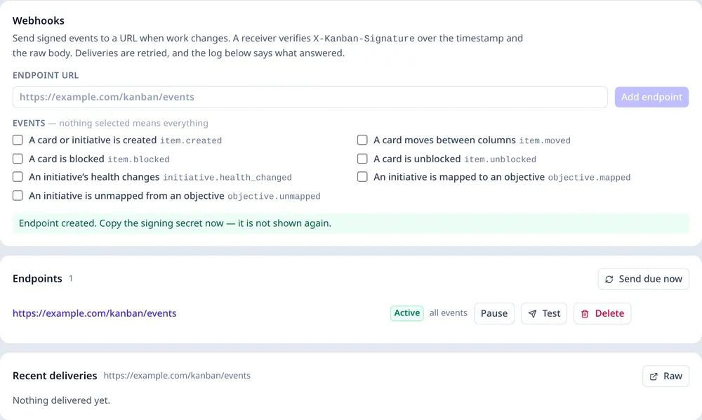

# Outbound webhooks

A webhook is a signed HTTP request this instance sends when the work changes: a receiver can post
into Slack, start a CI job, or keep a second system in step without polling the API or reading the
database.

A workspace administrator adds an endpoint under **Admin → Webhooks**. The endpoint is a URL, a set
of events and a signing secret. The secret is shown once, when the endpoint is made.



*Admin → Webhooks: one endpoint, the events it subscribes to, and the delivery log.*

## The events

| Event | When |
| --- | --- |
| `item.created` | A card or initiative is created. |
| `item.moved` | A card moves between columns. |
| `item.blocked` | A card is explicitly blocked. |
| `item.unblocked` | That block is cleared. |
| `item.noted` | A note is added to a card, with the mentions it names. |
| `item.updated` | A card’s fields are edited; `data.fields` names them, never the words themselves. |
| `initiative.health_changed` | The derived health of an initiative above the changed item changes. |
| `objective.mapped` | A top-level initiative is mapped to an objective. |
| `objective.unmapped` | That mapping is removed. |
| `webhook.test` | The administrator's test delivery. |

An endpoint with **no events selected** receives all of them. `initiative.health_changed` is a
convenience: health is derived, so a receiver can also compute it from the item events and the
workspace it already reads.

## The envelope

Every request body is one JSON object:

```json
{
  "id": "0f6a…",
  "type": "item.moved",
  "occurredAt": 1760000000000,
  "workspaceId": "workspace",
  "actorId": "u-riley",
  "data": {
    "itemId": "st-signup-rebuild",
    "title": "Rebuild the signup form",
    "boardId": "b-atlas",
    "fromStage": "inProgress",
    "toStage": "done"
  }
}
```

`data` is small: the ids and the words a receiver needs to fetch the rest from `/api/v1`. The whole
workspace is never sent.

## Verifying a delivery

Headers:

| Header | Meaning |
| --- | --- |
| `X-Kanban-Event` | The event type. |
| `X-Kanban-Delivery` | This attempt's id. |
| `X-Kanban-Timestamp` | Milliseconds since the epoch. |
| `X-Kanban-Signature` | `v1=` followed by the HMAC-SHA256 of `` `${timestamp}.${rawBody}` `` with the endpoint secret. |

Verify against the **raw body**, not a parsed object: re-serialising JSON changes the bytes and the
signature will not match. In Node:

```js
import { createHmac, timingSafeEqual } from 'node:crypto'

const expected = 'v1=' + createHmac('sha256', secret)
  .update(`${req.headers['x-kanban-timestamp']}.${rawBody}`)
  .digest('hex')
const received = req.headers['x-kanban-signature']
if (received.length !== expected.length || !timingSafeEqual(Buffer.from(received), Buffer.from(expected))) {
  return res.writeHead(401).end()
}
```

Reject a timestamp older than a few minutes if replay matters to the receiver. The instance retries,
so the same delivery id can arrive more than once; make the handler idempotent on `X-Kanban-Delivery`.

## Retries

A `2xx` response counts as delivered. Any other response is retried after one minute, five minutes,
thirty minutes and two hours. That is five attempts in all. After the fifth, the delivery is marked
failed. A `410 Gone` means the receiver has finished with the endpoint, so the endpoint is disabled
and not retried. Every attempt is kept in the delivery log
with its status, try count, answer and error, and a failed one can be retried by hand.

The dispatcher runs outside the request path: a self-hosted instance every fifteen seconds
(`WEBHOOKS=0` turns it off), a Worker from the cron trigger named in `wrangler.jsonc`. **Send due
now** on the admin screen asks for an immediate pass.

## Security

- The secret is 32 random bytes, returned once. A read never carries it again.
- Only a workspace administrator can create, change, pause, test or delete an endpoint.
- The URL is administrator-supplied and the request leaves the instance, so treat webhook access as
  an administrative power: it can reach any address the server can reach.
- A receiver that is down, slow or malicious cannot fail the write that caused the event. Delivery
  is a separate, retrying process.

## What it is not

There is no inbound webhook, no chat client and no digest. A webhook is an event out; a receiver
that wants people to read it writes that part. The event names and the envelope are meant to stay: a
notification or digest feature would build on them.
